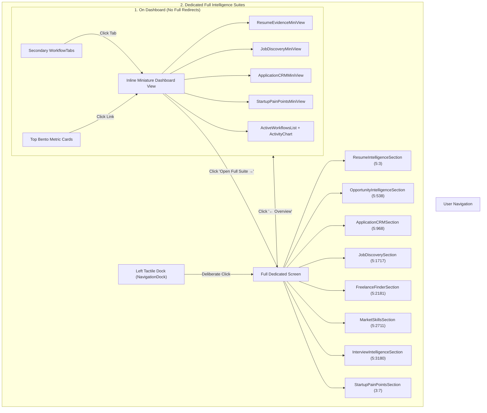

# RightFit — Technical Documentation & Architecture Guide

Welcome to the **RightFit** frontend codebase documentation. This document explains the tech stack, design system, component architecture, data flow, and the backend integration process.

---

## 🛠️ 1. Tech Stack Overview

| Category | Technology | Version | Purpose & Rationale |
| :--- | :--- | :--- | :--- |
| **Framework** | **Next.js (App Router)** | `14.2.35` | Server and client components, optimized static generation, modern App Router architecture (`src/app`). |
| **Language** | **TypeScript** | `5.x` | Strict type safety, explicit contracts for entities (Kanban cards, Job matches, Bounties, Telemetry). |
| **UI & Styling** | **Tailwind CSS** | `3.4.1` | Utility-first CSS with custom frosted-glass (`backdrop-blur-24px`), radial ambient glow, and tactile styling. |
| **Icons** | **Lucide React** | `^1.16.0` | Lightweight, scalable vector glyphs replacing ephemeral Figma asset CDN links. |
| **State Management** | **React Hooks (`useState`, `useEffect`)** | `18.3.1` | Local state, optimistic updates, and reactive tab/stage switching without unnecessary heavyweight libraries. |
| **Decoupled API Client** | **Custom Service Layer (`src/services/`)** | Custom | Modular `fetch` client with mock fallback toggle (`NEXT_PUBLIC_USE_MOCK_DATA`) for seamless future backend integration. |

---

## 📐 2. Figma Design Mapping (Page 1, Page 2, Page 3)

The application faithfully implements all screens from the **`rightfit`** Figma design:

```
rightfit (Figma Document Root: 0:0)
├── Page 1 (0:1)
│   └── 3:7: Startup Pain Points & Technical Founder Bounties
├── Page 2 (5:2)
│   ├── 5:3: Resume Intelligence & ATS Proof Engine
│   ├── 5:538: Opportunity Intelligence & Time Budget Optimizer
│   ├── 5:968: Application CRM (6-Stage Kanban Pipeline)
│   ├── 5:1717: AI Job Discovery (Semantic Radar & Cryptographic Verification)
│   ├── 5:2181: Freelance Finder (High-Bounty Architecture Sprints)
│   ├── 5:2711: Market & Skill Intelligence (Compensation & Skill Arbitrage)
│   └── 5:3180: Interview Intelligence (48h Itinerary & AI Whiteboard Simulator)
└── Page 3 (5:3594)
    └── 5:3595: Master Homepage / Overview Dashboard
```

---

## 📂 3. Directory & Component Architecture

```
untitled folder 3/
├── .env.example                         # Template environment variables
├── .env.local                           # Local environment config (Mock vs Real API toggle)
├── .gitignore                           # Git ignore rules (node_modules, .next, .env.local)
├── README.md                            # Quickstart and overview
├── ARCHITECTURE.md                      # This comprehensive documentation file
├── package.json                         # Dependencies and npm run scripts
├── tsconfig.json                        # TypeScript compiler settings
├── tailwind.config.ts                   # Tailwind theme extensions
└── src/
    ├── app/
    │   ├── globals.css                  # Ambient radial background gradients & tactile scrollbars
    │   ├── layout.tsx                   # Master HTML structure, metadata, system fonts
    │   └── page.tsx                     # Main orchestrator & screen switching engine
    ├── components/
    │   ├── NavigationDock.tsx           # Left tactile graphite pill dock (#1a1c21 capsule)
    │   ├── DashboardHeader.tsx          # Top window chrome: Breadcrumbs, Search (⌘K), Export, Action
    │   ├── MetricCardsRow.tsx           # 4 Bento quick stat cards (Executions, ATS, Pipeline, Salary)
    │   ├── WorkflowTabs.tsx             # Secondary segmented tab switcher with dynamic telemetry
    │   ├── ActiveWorkflowsList.tsx      # Real-time running background jobs & parser status
    │   ├── ActivityChart.tsx            # 7-day tactile CSS bar activity chart with Friday peak
    │   ├── HighValueSignals.tsx         # Recommended opportunities card stream
    │   ├── CreateActionModal.tsx        # Interactive action creation modal
    │   ├── ReportModal.tsx              # Telemetry & ATS audit proof modal
    │   ├── BackendGuideModal.tsx        # Slide-out guide for API integration
    │   ├── dashboard/                   # Inline Miniature Views (Keep user on Dashboard)
    │   │   ├── ResumeEvidenceMiniView.tsx      # Mini Master Resume & ATS verification meters
    │   │   ├── JobDiscoveryMiniView.tsx        # Mini Top 3 Radar jobs & quick apply
    │   │   ├── ApplicationCRMMiniView.tsx      # Mini 6-stage Kanban progress & spotlight offer
    │   │   └── StartupPainPointsMiniView.tsx   # Mini founder bottlenecks & $25k bounty quote
    │   └── sections/                    # Dedicated Full Intelligence Suites
    │       ├── ResumeIntelligenceSection.tsx       # Screen 5:3
    │       ├── OpportunityIntelligenceSection.tsx  # Screen 5:538
    │       ├── ApplicationCRMSection.tsx           # Screen 5:968
    │       ├── JobDiscoverySection.tsx             # Screen 5:1717
    │       ├── FreelanceFinderSection.tsx          # Screen 5:2181
    │       ├── MarketSkillsSection.tsx             # Screen 5:2711
    │       ├── InterviewIntelligenceSection.tsx    # Screen 5:3180
    │       └── StartupPainPointsSection.tsx        # Screen 3:7
    └── services/                        # Decoupled API Service Layer
        ├── types.ts                     # Strict TypeScript data models & contracts
        ├── endpoints.ts                 # REST endpoint URI dictionary
        ├── apiClient.ts                 # Fetch wrapper with mock toggle & error handling
        ├── mockData.ts                  # High-fidelity Figma-sourced mock state
        └── dashboardService.ts          # Unified service functions for data & mutations
```

---

## 🔄 4. How the Two-Tier Navigation Works

To balance high-density information without frustrating page redirects, the application uses an **intelligent two-tier navigation model**:



1. **Dashboard Stays on Dashboard**:
   - Clicking `Resume Evidence`, `Job Discovery`, `Application CRM`, or `Startup Pain Points` in the secondary tab bar does **not** redirect to another page. It renders a curated miniature view right inside the dashboard canvas.
   - Clicking `Audit ATS Proof →`, `View Kanban CRM →`, or `Review Opportunities →` on the Bento cards activates that respective mini view inline.
2. **Dedicated Full Screens**:
   - The user can intentionally open any full screen using the **Left Tactile Graphite Pill Dock** or by clicking the **`Open Full Suite →`** button in any mini view.
   - Inside any full screen, a prominent **`← Overview`** button in the header bar returns to the dashboard with 1 click.

---

## 🔌 5. Connecting Your Premade Backend

The frontend was built strictly frontend-only, with an abstracted data layer designed for plug-and-play backend integration.

### The Service Layer Flow:
```
UI Component → DashboardService.ts → apiClient.ts → [Premade Backend OR Mock Data]
```

### To Connect Your Real Backend:
1. Open `.env.local` in the project root:
   ```env
   # Set to false to bypass mock data and call your real backend
   NEXT_PUBLIC_USE_MOCK_DATA=false

   # Set to your backend's API base URL
   NEXT_PUBLIC_API_BASE_URL=https://api.yourdomain.com
   ```
2. Your backend needs to implement the endpoints defined in `src/services/endpoints.ts`:
   - `GET /api/dashboard`: Homepage metrics, active workflows, activity chart, signals.
   - `GET /api/crm`: Kanban pipeline cards and stage stats.
   - `PATCH /api/crm/cards/:id`: Update card stage (`saved`, `ready`, `applied`, `assessment`, `interview`, `offer`).
   - `GET /api/jobs`: Semantic job matches and cryptographic proofs.
   - `GET /api/freelance`: Fractional sprint leads and problem statements.
   - `POST /api/freelance/:id/pitch`: Send customized technical proposal.
   - `GET /api/market-skills`: Compensation percentiles, skill arbitrage index, and roadmap.
   - `GET /api/interview`: Readiness score, 48h itinerary, simulator scorecard.
   - `GET /api/pain-points`: Cataloged founder bottlenecks and bounty amounts.
   - `POST /api/pain-points/:id/solution`: Submit solution architecture memo.

---

## 🚢 6. Git Branch & Remote Push Steps

The repository has been initialized with the `frontend` branch.

### Push to GitHub:
```bash
# 1. Add your remote repository (replace with your repo URL)
git remote add origin https://github.com/<OWNER>/beta-08.git

# 2. Push the frontend branch to GitHub
git push -u origin frontend
```

If you use SSH:
```bash
git remote add origin git@github.com:<OWNER>/beta-08.git
git push -u origin frontend
```
