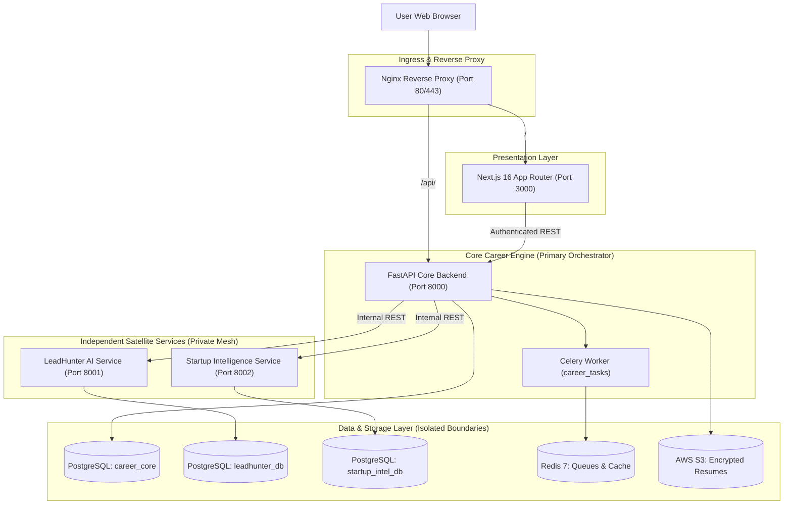

# RIGHT FIT 🎯
### AI-Powered Career & Opportunity Intelligence Platform

[](#10-current-implementation-status)
[](#5-approved-architecture)
[](#8-technology-overview-verified-phase-0-findings)
[](#8-technology-overview-verified-phase-0-findings)
[](#8-technology-overview-verified-phase-0-findings)
[](#8-technology-overview-verified-phase-0-findings)

---

## 1. Product Identity

**RIGHT FIT** is an enterprise-grade AI-powered career and opportunity intelligence system. Unlike traditional, passive job boards that rely solely on keyword matching and flood candidates with generic listings, RIGHT FIT acts as an autonomous personal intelligence agent for job seekers, career changers, freelancers, and independent developers.

RIGHT FIT is **NOT merely a job portal or resume builder**. It is a centralized opportunity intelligence engine that unifies full-time ATS job discovery, local business freelance lead prospecting, and startup technical pain-point mining into a single, explainable platform.

---

## 2. Problem Statement

The modern professional opportunity ecosystem is fragmented, noisy, and inefficient:
1. **Opaque & Inefficient Job Search:** Job seekers spend 20+ hours a week tailoring resumes for black-box ATS algorithms without knowing why they are rejected.
2. **Ghost Listings & Stale Roles:** Over 30% of posted online jobs are inactive or phantom postings designed to build candidate pipelines.
3. **Manual Freelance Prospecting:** Freelancers and agencies manually search directories to identify businesses with broken or non-existent websites.
4. **Scattered Startup Bottlenecks:** Startups post technical challenges and "help wanted" signals across Reddit, GitHub, and niche communities without a central discovery engine.

---

## 3. Product Vision

RIGHT FIT bridges the gap between what individuals have to offer and where high-value market demand exists:
* **Explainable Matching:** Every recommendation is paired with deterministic rationale traces showing matched and missing skills.
* **Unified Opportunity Stream:** Access full-time employment roles, local business freelance leads, and startup technical opportunities from a single dashboard.
* **Human-in-the-Loop Safety:** Applications and pitches are drafted with AI assistance but strictly require human approval before dispatch.
* **Holistic Career Intelligence:** Offers compensation calculators, equity cliff analysis, STAR interview prep briefs, and offer negotiation strategy.

---

## 4. Nine Product Modules

| Module ID | Module Name | Scope & Core Responsibility | Implementation Status |
| :--- | :--- | :--- | :--- |
| **MOD-01** | **Overview Dashboard** | Unified metrics aggregation, conversion funnel charts, and opportunity feeds. | Planned (Phase 11) |
| **MOD-02** | **Resume Intelligence** | PDF/DOCX resume extraction, ATS keyword coverage, and skill-gap diagnostics. | In Development (Phase 3) |
| **MOD-03** | **AI Job Discovery** | Ingestion from 70+ ATS adapters (Greenhouse, Lever, Ashby, Workday) and ghosting detection. | Planned (Phase 4) |
| **MOD-04** | **Opportunity Intelligence Engine** | Deterministic fit scoring (0–100%), priority tiering, and explainable rationale traces. | Planned (Phase 5) |
| **MOD-05** | **Application CRM** | Visual Kanban tracking across stages (`saved` ➔ `applied` ➔ `interview` ➔ `offer`). | Planned (Phase 6) |
| **MOD-06** | **Freelance Opportunity Finder** | Google Maps business discovery, website availability audits, and proposal drafting. | Planned (Phase 9) |
| **MOD-07** | **Startup Pain Point Discovery** | Community crawler (Reddit, GitHub, HN, RSS) and Gemini technical problem classifier. | Planned (Phase 10) |
| **MOD-08** | **Market & Skill Intelligence** | Salary band estimation, cost-of-living adjustments, RSU refresh cliffs, and benefit gaps. | Planned (Phase 12) |
| **MOD-09** | **Interview Intelligence** | STAR story formulation, likely technical questions, schedule conflict detection, debriefs. | Planned (Phase 8) |

---

## 5. Approved Architecture (Option A: Hybrid Modular Architecture)

RIGHT FIT follows a **Hybrid Modular Architecture**:
* **Core Career Engine:** Central orchestrator for user identity, resume intelligence, ATS job matching, and application workflows. Evolves from the mature `agentic-career-search` codebase.
* **Independent LeadHunter Service:** Autonomous satellite service discovering local business website gaps and broken sites.
* **Independent Startup Intelligence Service:** Autonomous satellite service discovering startup pain points across Reddit, GitHub, Hacker News, and launch communities.
* **Unified Presentation Layer:** Single Next.js 16 application communicating strictly with Core Backend over authenticated REST APIs.

---

## 6. Service Ownership

| Service Name | Repository Context | Responsibility Domain | Primary Data Store | Primary Interface |
| :--- | :--- | :--- | :--- | :--- |
| **Core Career Engine** | `backend/` | Auth, Profiles, Resumes, Jobs, Matching, CRM, Compensation | `career_core` schema | Core REST API (`/api/v1/*`) |
| **LeadHunter AI** | `services/leadhunter/` | Google Maps scraper, broken-site testing, social crawler | `leadhunter_db` schema | Internal REST API (Port 8001) |
| **Startup Intelligence** | `services/startup_intelligence/` | Reddit, GitHub, Hacker News, Dev.to scrapers, Gemini AI | `startup_intel_db` schema | Internal REST API (Port 8002) |
| **Unified Frontend** | `frontend/` | Presentation, interactive dashboards, Kanban pipelines | Stateless / Local UI State | Next.js 16 Web (Port 3000) |

---

## 7. High-Level Architecture Diagram



---

## 8. Technology Overview (Verified Phase 0 Findings)

Based on the verified Phase 0 audit:
* **Host Runtime:** Python 3.13.15, Node.js v22.23.4, npm 10.9.9.
* **Backend Stack:** Python 3.11+, FastAPI, Pydantic v2, SQLAlchemy 2.0.35, Alembic, HTTPX.
* **Frontend Stack:** Next.js 16.2.10, React 19.2.4, Tailwind CSS v4, TypeScript 5.
* **Database & Queue:** PostgreSQL 16 (with schema isolation), Redis 7 (Celery background worker queue).
* **AI & LLM Services:** Google Gemini API (model `gemini-2.0-flash` with local deterministic fallback templates).
* **Testing Engines:** Pytest 9.1.0, Pytest-Asyncio.

---

## 9. Repository Documentation Links

* [Supreme Rulebook (`AGENTS.md`)](./AGENTS.md)
* [Contributing Guide (`CONTRIBUTING.md`)](./CONTRIBUTING.md)
* [Central Documentation Index (`docs/README.md`)](./docs/README.md)
* [Architecture Specifications (`docs/architecture/`)](./docs/architecture/)
  * [System Overview](./docs/architecture/overview.md)
  * [Service Ownership Mapping](./docs/architecture/service-ownership.md)
  * [Data Ownership & Schema Isolation](./docs/architecture/data-ownership.md)
  * [API Communication Protocol](./docs/architecture/api-communication.md)
* [Engineering Standards (`docs/standards/`)](./docs/standards/)
  * [Development Workflow](./docs/standards/development.md)
  * [Universal Naming Conventions](./docs/standards/naming-conventions.md)
  * [REST API Standards](./docs/standards/api-standards.md)
  * [Database Standards](./docs/standards/database-standards.md)
  * [Security & Privacy Standards](./docs/standards/security-standards.md)
  * [Documentation Standards](./docs/standards/documentation-standards.md)
* [Architecture Decision Records (`docs/adr/`)](./docs/adr/)
  * [ADR-0001: Hybrid Modular Architecture](./docs/adr/0001-hybrid-architecture.md)
  * [ADR-0002: Service & Data Ownership](./docs/adr/0002-service-data-ownership.md)
* [Phase 0 Audit Deliverables (`docs/audit/phase-0/`)](./docs/audit/phase-0/)
* [Phase 1 Execution Record (`docs/operations/phase-1-execution-record.md`)](./docs/operations/phase-1-execution-record.md)

---

## 10. Current Implementation Status

```text
================================================================================
CURRENT PHASE: Phase 1 — Product Foundation and Governance
STATUS: READY FOR HANDOVER & REVIEW
IMPLEMENTED WORK: Directory Skeleton, Standards, Architecture Specs, ADRs
APPLICATION CODE: NOT IMPLEMENTED (Strict Phase 1 Exclusion)
================================================================================
```

### Module Status Breakdown:
* **Overview Dashboard:** `Planned`
* **Resume Intelligence:** `In Development` (Scoring verified in Phase 0; PDF parser planned for Phase 3)
* **AI Job Discovery:** `Planned` (70+ source adapters verified in Phase 0)
* **Opportunity Intelligence Engine:** `Planned` (Decision engine verified in Phase 0)
* **Application CRM:** `Planned` (Stage transitions verified in Phase 0)
* **Freelance Opportunity Finder:** `Planned` (LeadHunter engine verified in Phase 0)
* **Startup Pain Point Discovery:** `Planned` (Community scrapers verified in Phase 0)
* **Market & Skill Intelligence:** `Planned` (Compensation calculators verified in Phase 0)
* **Interview Intelligence:** `Planned` (STAR brief generators verified in Phase 0)

---

## 11. Development Principles

1. **Deterministic Over Heuristic:** Decision scoring and skill matching must be deterministic, transparent, and explainable.
2. **Strict Boundary Isolation:** No direct cross-service database access. All data exchange flows through versioned REST contracts.
3. **Inspect Before Building:** Check existing legacy capabilities (`agentic-career-search`, `ai agents`, `Startups-problrms-hunter`) before implementing new features.
4. **Phase Discipline:** Strictly follow the approved phase-by-phase roadmap. Never silently skip phases or expand scope.

---

## 12. Security & Privacy Principles

1. **Human-in-the-Loop (HITL):** No automated application submissions or cold emails are dispatched without explicit user review and confirmation.
2. **Candidate PII Protection:** Resumes are treated as strictly confidential PII and stored in encrypted S3 buckets with expiring access URLs.
3. **Zero Secrets in Source Control:** Credentials and API keys are injected exclusively via environment variables; `.env` is universally gitignored.
4. **No Direct Socket Handshakes:** Outbound email address verification via direct SMTP handshakes is strictly prohibited to protect IP reputation.

---

## 13. Phase-Wise Product Roadmap

* **Phase 0 (Completed):** Repository Discovery & Legacy Technical Audit.
* **Phase 1 (Active):** Product Foundation & Governance Setup.
* **Phase 2 (Planned):** Service Communication Contracts & Local Docker Compose Setup.
* **Phase 3 (Planned):** Resume Intelligence & Core Schema Implementation.
* **Phase 4 (Planned):** ATS Source Adapters & Job Discovery Ingestion.
* **Phase 5 (Planned):** Deterministic Opportunity Matching Engine.
* **Phase 6 (Planned):** Application CRM Pipeline.
* **Phase 7 (Planned):** User Authentication & Profile Management.
* **Phase 8 (Planned):** Interview Preparation Intelligence.
* **Phase 9 (Planned):** LeadHunter Freelance Service Integration.
* **Phase 10 (Planned):** Startup Intelligence Service Integration.
* **Phase 11 (Planned):** Unified Next.js Presentation Dashboard.
* **Phase 12 (Planned):** Market, Skills & Compensation Intelligence.
* **Phase 13 (Planned):** Production Hardening, Nginx & AWS Deployment.
* **Phase 14 (Planned):** Beta Verification & User Testing.

---

## 14. Contribution & Governance

Contributions must adhere to the engineering standards and pull request workflows documented in [`CONTRIBUTING.md`](./CONTRIBUTING.md).
# BETA-08

