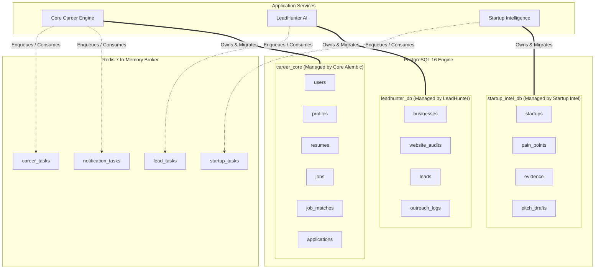

# Data Ownership Diagram

- **Title:** Relational Schema & Queue Ownership Diagram
- **Purpose:** Visualizes data ownership boundaries, schema isolation, and Redis queue allocations.
- **Status:** APPROVED
- **Owner:** Database Architect (UNASSIGNED)
- **Last Updated:** 2026-10-31

---

---

## Data Boundary Directives
* Direct queries across schemas are strictly prohibited.
* Data exchange between schemas occurs exclusively via authenticated REST API endpoints.

