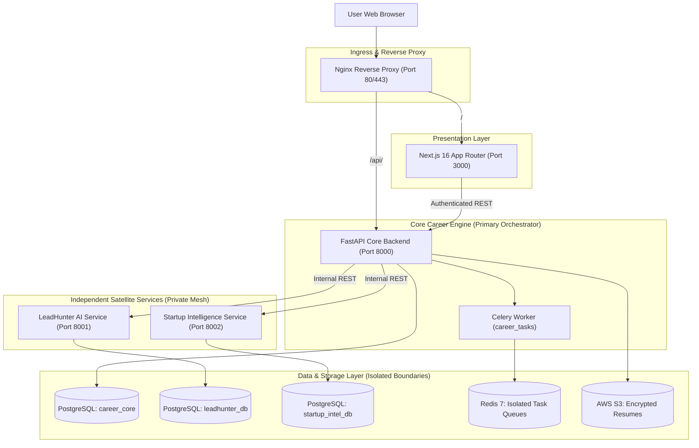

# High-Level Architecture Diagram

- **Title:** RIGHT FIT Option A Hybrid Architecture Diagram
- **Purpose:** Visualizes subsystem topology, service-to-service communication paths, and isolated storage boundaries.
- **Status:** APPROVED
- **Owner:** Principal Architect (UNASSIGNED)
- **Last Updated:** 2026-10-31

---

---

## Architectural Rules Illustrated
1. **Frontend Isolation:** Client requests enter through Nginx; web browser never connects directly to satellite services.
2. **Private Network Mesh:** LeadHunter and Startup Intelligence reside in the internal Docker network (`rightfit-network`).
3. **Database Boundary Protection:** Each service connects strictly to its own dedicated database schema.

