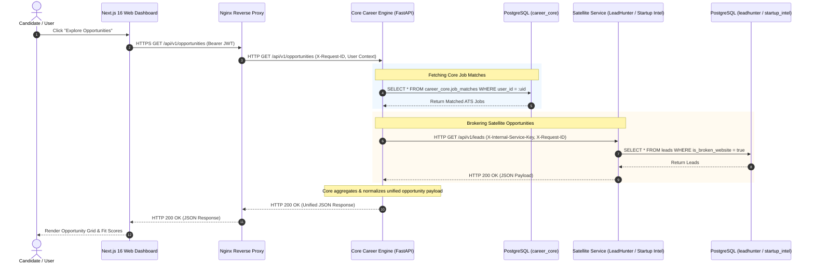

# Request Communication Flow Diagram

- **Title:** End-to-End Request Flow & Response Lifecycles
- **Purpose:** Visualizes synchronous and asynchronous request propagation from user action through Core API, satellite services, and database layers.
- **Status:** APPROVED
- **Owner:** Principal Architect (UNASSIGNED)
- **Last Updated:** 2026-10-31

---

