# Service Ownership Diagram

- **Title:** Product Capabilities Service Ownership Diagram
- **Purpose:** Visualizes the allocation of product modules and functional capabilities across services.
- **Status:** APPROVED
- **Owner:** Principal Architect (UNASSIGNED)
- **Last Updated:** 2026-10-31

---

```mermaid
flowchart LR
    subgraph CoreEngine ["Core Career Engine (FastAPI)"]
        direction TB
        C1["User Authentication & Tenancy"]
        C2["Resume Parsing & Skills Fit"]
        C3["70+ ATS Job Ingestion Adapters"]
        C4["Deterministic Match Scorer"]
        C5["Application CRM State Machine"]
        C6["Compensation & Benefit Calculators"]
        C7["STAR Story & Interview Prep"]
        C8["Unified Opportunity Orchestrator"]
    end

    subgraph LeadHunterService ["LeadHunter AI (Independent FastAPI)"]
        direction TB
        L1["Google Maps Local Lead Scraper"]
        L2["Website DNS/SSL/HTTP Health Auditor"]
        L3["Deep Social & Contact Crawler"]
        L4["AI Sales Pitch Generator"]
        L5["IMAP Email Reply Tracker"]
    end

    subgraph StartupService ["Startup Intelligence (Independent FastAPI)"]
        direction TB
        S1["Reddit Community Feed Scraper"]
        S2["GitHub 'Help Wanted' Issue Scraper"]
        S3["Hacker News & Product Hunt Crawler"]
        S4["Gemini Technical Pain-Point Classifier"]
        S5["Startup Evidence & Provenance Store"]
    end

    subgraph FrontendApp ["Unified Next.js 16 Frontend"]
        direction TB
        F1["Authentication & Protected Routes"]
        F2["Candidate Resume Studio"]
        F3["ATS Matched Jobs Explorer"]
        F4["Visual Application CRM Kanban"]
        F5["Freelance Lead Pipeline"]
        F6["Startup Pain-Point Explorer"]
    end

    FrontendApp -->|REST API| CoreEngine
    CoreEngine -->|Brokered REST| LeadHunterService
    CoreEngine -->|Brokered REST| StartupService
```

