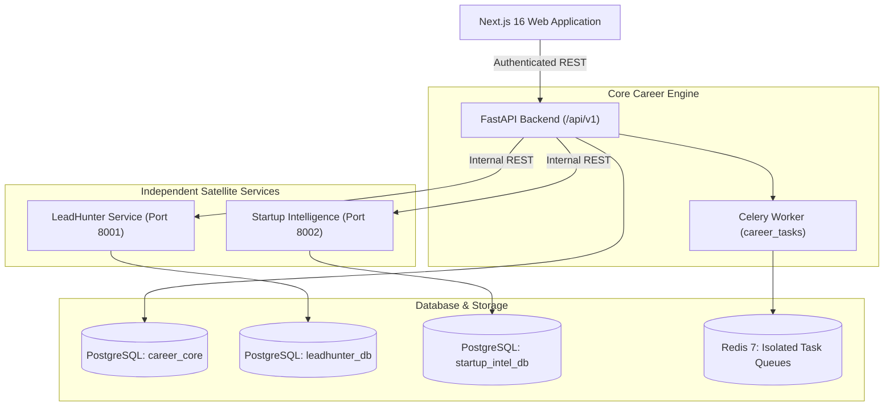

# System Architecture Overview

- **Title:** RIGHT FIT System Architecture Blueprint
- **Purpose:** Outlines the Option A Hybrid Modular Architecture, subsystem responsibilities, and deployment topologies.
- **Status:** APPROVED
- **Owner:** Principal Architect (UNASSIGNED)
- **Last Updated:** 2026-10-31

---

## 1. Architectural Philosophy
RIGHT FIT adopts **Option A — Hybrid Modular Architecture**. Rather than deploying an overly complex microservice mesh with 10+ independent services, or conversely an unwieldy single monolithic codebase, RIGHT FIT strategically separates core transactional capabilities from asynchronous web crawlers.

### The Subsystems:
1. **Core Career Engine (`backend/`):** Primary backend API and asynchronous task worker. Owns user identity, candidate profiles, resume parsing, ATS job matching, application tracking CRM, and orchestration. Evolves from `agentic-career-search`.
2. **LeadHunter AI Service (`services/leadhunter/`):** Autonomous satellite service executing Google Maps scraping, website DNS/SSL/HTTP availability audits, and deep social crawler tasks.
3. **Startup Intelligence Service (`services/startup_intelligence/`):** Autonomous satellite service scanning Reddit, GitHub ("help wanted"), Hacker News, and RSS feeds, analyzing technical signals via Google Gemini.
4. **Unified Presentation Layer (`frontend/`):** Single Next.js 16 Web Dashboard serving jobs, freelance leads, and startup opportunities to the end user.

---

## 2. Subsystem Topology & Boundaries

---

## 3. Core Architectural Rules
* **No Direct Frontend-to-Satellite Access:** The web browser NEVER connects directly to LeadHunter or Startup Intelligence. All requests are brokered by the Core Career Engine.
* **No Cross-Service Direct Database Access:** `career_core`, `leadhunter_db`, and `startup_intel_db` are isolated schemas. No SQL queries may join across schemas.
* **Statelessness:** All service containers maintain no local disk state and can be scaled horizontally.

For individual subsystem specifications, see:
- [Service Ownership Mapping](./service-ownership.md)
- [Data Ownership & Schema Isolation](./data-ownership.md)
- [API Communication Protocols](./api-communication.md)
- [ADR-0001: Hybrid Modular Architecture](../adr/0001-hybrid-architecture.md)

