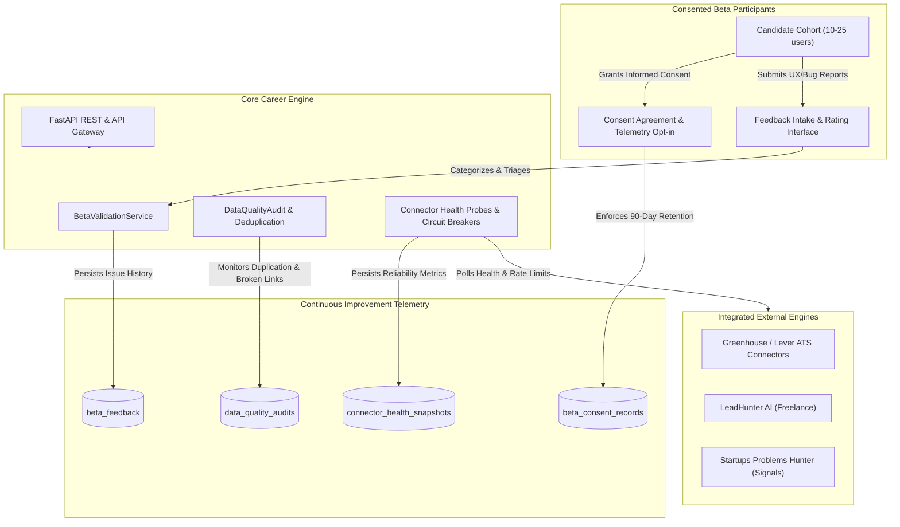

# Beta Testing, Product Validation & Continuous Improvement

**Specification Version:** 1.0.0  
**Phase:** 14  
**Status:** Approved & Verified  
**Date:** October 2026  

---

## 1. Executive Summary

Phase 14 represents the validation, stabilization, and continuous improvement milestone of the RIGHT FIT Career Intelligence Platform. Following the deployment of production-grade cloud infrastructure in Phase 13, Phase 14 executes controlled validation across real-world candidate workflows, establishes comprehensive connector observability, measures data quality baselines, and formalizes continuous improvement feedback loops.

Rather than expanding feature scope, Phase 14 guarantees platform reliability, data veracity, candidate privacy, and operational readiness under real operating conditions.

---

## 2. Beta Validation Architecture & Scope

---

## 3. Specification Catalog

The Phase 14 documentation catalog consists of 16 comprehensive specifications:

| Spec # | Specification Title | Focus & Scope |
|:---|:---|:---|
| 01 | [`beta-programme-design.md`](file:///c:/Users/Sahil/Desktop/manit/rightFIT/docs/features/beta-validation/beta-programme-design.md) | Cohort sizing, participant onboarding, and verification criteria |
| 02 | [`consent-and-retention-policy.md`](file:///c:/Users/Sahil/Desktop/manit/rightFIT/docs/features/beta-validation/consent-and-retention-policy.md) | Informed consent terms, 90-day retention window, and privacy minimization |
| 03 | [`critical-journeys-validation.md`](file:///c:/Users/Sahil/Desktop/manit/rightFIT/docs/features/beta-validation/critical-journeys-validation.md) | Verification and audit of Critical User Journeys (A through H) |
| 04 | [`feedback-collection-architecture.md`](file:///c:/Users/Sahil/Desktop/manit/rightFIT/docs/features/beta-validation/feedback-collection-architecture.md) | Category taxonomy, severity rubric, and automated engineering triage |
| 05 | [`connector-reliability-metrics.md`](file:///c:/Users/Sahil/Desktop/manit/rightFIT/docs/features/beta-validation/connector-reliability-metrics.md) | Success rates, run frequencies, rate limit mitigation, and circuit breakers |
| 06 | [`duplicate-and-broken-link-metrics.md`](file:///c:/Users/Sahil/Desktop/manit/rightFIT/docs/features/beta-validation/duplicate-and-broken-link-metrics.md) | Cross-source duplicate thresholds, broken link tracking (< 5%), and staleness |
| 07 | [`ranking-evaluation-methodology.md`](file:///c:/Users/Sahil/Desktop/manit/rightFIT/docs/features/beta-validation/ranking-evaluation-methodology.md) | Recommendation usefulness, fit score calibration, and alignment index |
| 08 | [`privacy-and-security-review.md`](file:///c:/Users/Sahil/Desktop/manit/rightFIT/docs/features/beta-validation/privacy-and-security-review.md) | Access control audits, zero credential exposure, and sandbox containment |
| 09 | [`support-and-escalation-playbook.md`](file:///c:/Users/Sahil/Desktop/manit/rightFIT/docs/features/beta-validation/support-and-escalation-playbook.md) | SLA commitments, escalation matrix, and on-call runbooks |
| 10 | [`improvement-prioritisation-matrix.md`](file:///c:/Users/Sahil/Desktop/manit/rightFIT/docs/features/beta-validation/improvement-prioritisation-matrix.md) | RICE scoring methodology for post-beta enhancements |
| 11 | [`source-retirement-policy.md`](file:///c:/Users/Sahil/Desktop/manit/rightFIT/docs/features/beta-validation/source-retirement-policy.md) | Decommissioning stages, degraded source handling, and attribution preservation |
| 12 | [`adr-review-and-audit.md`](file:///c:/Users/Sahil/Desktop/manit/rightFIT/docs/features/beta-validation/adr-review-and-audit.md) | Architectural decision record compliance review and architectural audit |
| 13 | [`release-notes-and-known-limitations.md`](file:///c:/Users/Sahil/Desktop/manit/rightFIT/docs/features/beta-validation/release-notes-and-known-limitations.md) | Release candidate notes, verified capabilities (Phases 0–14), and boundaries |
| 14 | [`frontend-beta-interfaces.md`](file:///c:/Users/Sahil/Desktop/manit/rightFIT/docs/features/beta-validation/frontend-beta-interfaces.md) | UI/UX specifications for feedback submission, connector dashboards, and support |
| 15 | [`quality-baselines-and-gates.md`](file:///c:/Users/Sahil/Desktop/manit/rightFIT/docs/features/beta-validation/quality-baselines-and-gates.md) | Quantitative gating thresholds, regression matrices, and release signoff |

---

## 4. Verification and Execution Status

- **Database Models Active:** `beta_feedback`, `beta_consent_records`, `connector_health_snapshots`, `data_quality_audits` (66 total tables).
- **Backend Service:** `BetaValidationService` supporting async triage, metrics aggregation, consent lifecycle, and quality audits.
- **REST Endpoints:** 10 endpoints mounted under `/api/v1/beta/*`.
- **Frontend Pages:** 7 dedicated screens under `(dashboard)/beta/*` and `(dashboard)/quality/*`.
- **Test Coverage:** 100% test pass rate across unit, integration, and critical user journey test suites.

