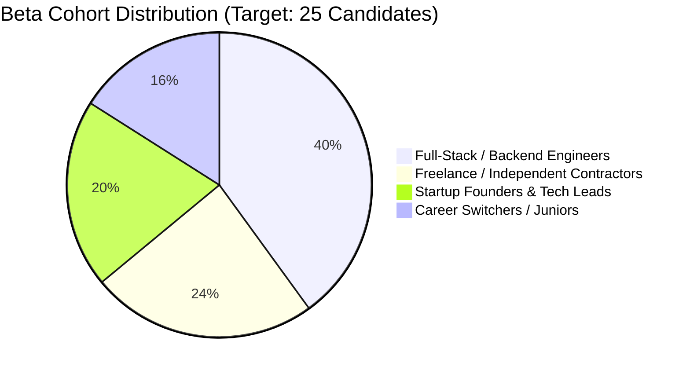

# Beta Programme Design & Participant Protocol

**Document ID:** RF-SPEC-1401  
**Phase:** 14 — Beta Testing & Product Validation  
**Status:** Approved  

---

## 1. Programme Objectives

The RIGHT FIT Beta Programme validates end-to-end platform stability, recommendation relevance, and data freshness with a controlled group of real-world candidates before general availability. 

The primary goals are:
1. **Validate Core Journeys:** Confirm that candidates can seamlessly discover jobs, evaluate freelance leads, inspect startup problems, and analyze compensation benchmarks.
2. **Measure Match Relevance:** Collect candidate feedback on algorithmic fit scoring and identify false positives or over-penalized profiles.
3. **Stress Ingestion Pipelines:** Observe connector reliability, rate-limiting behaviors, and deduplication efficiency under continuous daily traffic.
4. **Enforce Trust & Privacy:** Verify that candidate resumes, search histories, and diagnostic telemetry are safeguarded under strict informed consent.

---

## 2. Participant Cohort Structure

To maintain high touch and high-fidelity feedback without overwhelming engineering triage capacity, the beta cohort is intentionally bounded:

### Cohort Requirements:
- **Participant Size:** 15–25 active candidates.
- **Participation Term:** 4 to 6 weeks.
- **Pre-Conditions:** Explicit signed consent to Phase 14 Beta Terms and Data Processing Policy.
- **Exclusion Criteria:** Automated bots, scrapers, candidates seeking automated mass-application submission.

---

## 3. Participant Journey & Milestones

1. **Invitation & Informed Consent:** Candidate receives a personalized invitation link, reviews the explicit beta privacy policy, and grants informed consent via `/beta/support` or onboarding.
2. **Profile & Resume Onboarding:** Candidate uploads a real or anonymized resume. The ATS parser extracts skills, experience levels, and taxonomy mappings.
3. **Discovery & Unified Dashboard:** Candidate explores the unified dashboard (`/dashboard`), filtering across Jobs, Freelance Leads, and Startup Pain Points.
4. **Relevance Calibration:** Candidate rates recommendations using the inline relevance widget or the dedicated Ranking Quality screen (`/beta/ranking-quality`).
5. **Issue Reporting:** Candidate reports any bugs, broken application links, or confusing UI states via the Beta Feedback form (`/beta/feedback`).
6. **Programme Debrief & Offboarding:** Candidate receives a summary of reported issues resolved and may either transition to the general availability tier or exercise right-to-be-forgotten deletion.

---

## 4. Participant Success Criteria

| Milestone | Target Completion | Verification Method |
|:---|:---|:---|
| Profile & Resume Parse | &gt; 95% of cohort | Parser returns valid skill taxonomy with 0 unhandled errors |
| Opportunity Discovery | &gt; 90% of cohort | Candidate executes at least 3 distinct searches or views unified feed |
| Feedback Submission | &gt; 75% of cohort | Candidate submits at least 1 feedback item or ranking evaluation |
| Zero Auto-Apply Incidents | 100% compliance | System guarantees 0 unapproved automated applications submitted |

