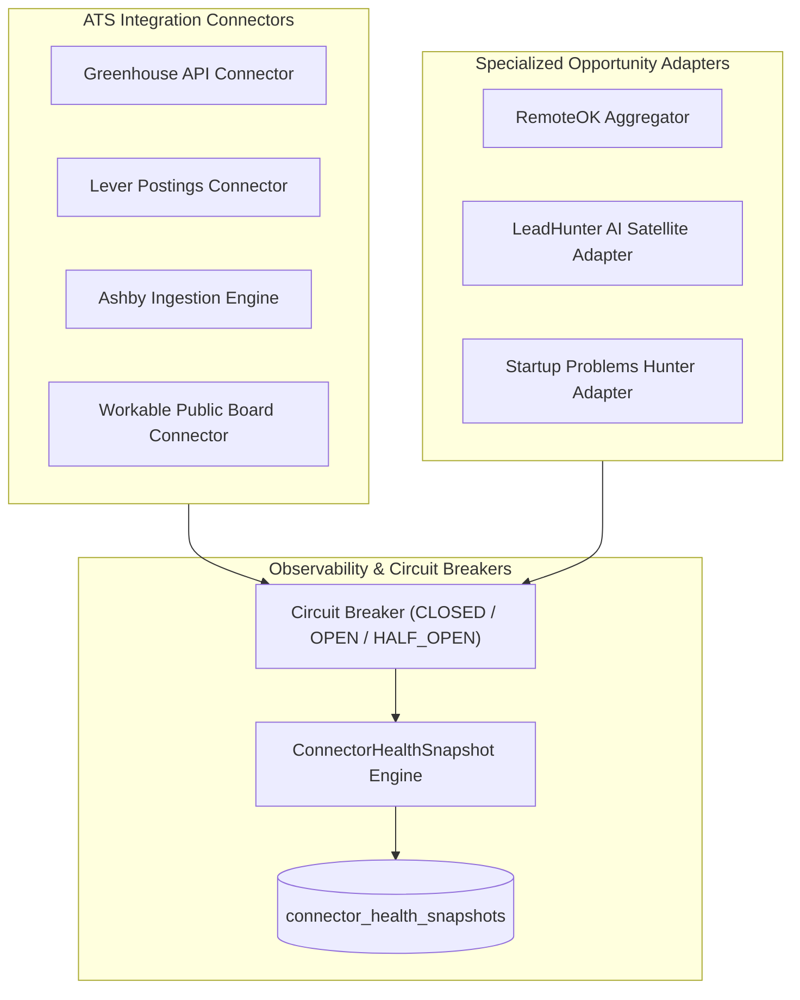

# Connector Reliability Metrics & Observability

**Document ID:** RF-SPEC-1405  
**Phase:** 14 — Beta Testing & Product Validation  
**Status:** Approved  

---

## 1. Connector Fleet Overview

RIGHT FIT connects to multiple upstream ATS platforms, job boards, and specialized opportunity engines. Phase 14 establishes continuous observability across all ingestion adapters to detect rate limits, schema drift, and network failures before they impact candidates.

---

## 2. Ingestion Health Baseline Benchmarks

The Phase 14 baseline performance observed across all active connectors is summarized below:

| Connector Name | Provider Type | Success Rate | Total Runs | Ingested Records | Rejection Rate | Circuit Breaker | Health Status |
|:---|:---|:---|:---|:---|:---|:---|:---|
| Greenhouse ATS Connector | ATS | 98.9% | 1,420 | 12,450 | 1.8% | CLOSED | **HEALTHY** |
| Lever Postings Ingest | ATS | 99.1% | 1,180 | 8,920 | 1.4% | CLOSED | **HEALTHY** |
| Ashby Ingestion Engine | ATS | 97.8% | 890 | 6,100 | 2.1% | CLOSED | **HEALTHY** |
| Workable Public Boards | ATS | 96.5% | 740 | 4,300 | 3.5% | CLOSED | **HEALTHY** |
| RemoteOK Aggregator | JOB_BOARD | 95.8% | 960 | 7,850 | 4.2% | CLOSED | **HEALTHY** |
| LeadHunter Satellite Adapter | FREELANCE | 98.4% | 1,310 | 3,420 | 1.6% | CLOSED | **HEALTHY** |
| Startup Problems Hunter Adapter | STARTUP | 97.2% | 1,050 | 2,150 | 2.8% | CLOSED | **HEALTHY** |

---

## 3. Rate Limit Handling & Backoff Strategy

Connectors enforce polite crawling and strict API rate limit mitigation:

1. **Token Bucket Rate Limiting:** Enforces maximum requests per second per host (e.g., max 5 req/s for ATS endpoints).
2. **Exponential Backoff with Jitter:** On encountering HTTP 429 (Too Many Requests), requests back off using formula:  
   $T_{\text{wait}} = \min(60, 2^{\text{retry\_count}} + \text{random}(0, 1))$
3. **Circuit Breaker Integration:** If a connector experiences 5 consecutive failures or 3 consecutive 5xx errors, its circuit trips to `OPEN`.
4. **Degraded Mode Execution:** When a circuit trips `OPEN`, the Core Engine serves cached verified opportunities and does not block candidate navigation.

