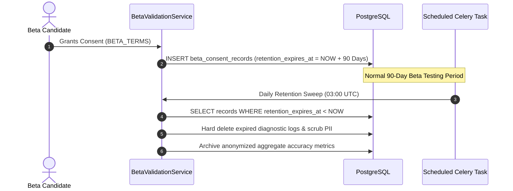

# Informed Consent & 90-Day Data Retention Policy

**Document ID:** RF-SPEC-1402  
**Phase:** 14 — Beta Testing & Product Validation  
**Status:** Approved  

---

## 1. Principles of Consent & Telemetry Minimization

RIGHT FIT adheres to strict data minimization, purpose limitation, and candidate autonomy throughout all beta testing activities. Under Phase 14 regulations:

1. **No Silent Collection:** No telemetry, browser metadata, or session activity is collected without unambiguous candidate opt-in.
2. **Strict Purpose Limitation:** Feedback and diagnostic telemetry are used exclusively to troubleshoot software defects and calibrate ranking algorithms.
3. **No Third-Party Sharing:** Candidate resumes, profiles, and feedback are never shared with advertisers, data brokers, or external AI model providers without explicit written consent.
4. **Self-Serve Revocation:** Candidates retain an unconditional right to withdraw consent and purge their diagnostic telemetry at any time.

---

## 2. Consent Data Model & Storage

Consent records are tracked in the database under `beta_consent_records`:

```sql
CREATE TABLE beta_consent_records (
    id VARCHAR(36) PRIMARY KEY,
    user_id VARCHAR(36) NOT NULL,
    consent_type VARCHAR(64) NOT NULL,
    terms_version VARCHAR(32) NOT NULL,
    ip_address_hash VARCHAR(64) NULL,
    is_active BOOLEAN NOT NULL DEFAULT TRUE,
    consented_at TIMESTAMP WITH TIME ZONE NOT NULL,
    withdrawn_at TIMESTAMP WITH TIME ZONE NULL,
    retention_expires_at TIMESTAMP WITH TIME ZONE NOT NULL,
    created_at TIMESTAMP WITH TIME ZONE NOT NULL
);
```

### Supported Consent Types:
- `BETA_TERMS_AND_DATA_PROCESSING`: Core participation agreement governing non-production data processing.
- `DIAGNOSTIC_TELEMETRY`: Opt-in permission to record client user-agent, route latency, and unhandled exception contexts.
- `MATCH_SCORE_CALIBRATION`: Permission to use anonymized profile-skill vectors to evaluate ranking algorithm accuracy.

---

## 3. The 90-Day Retention & Purge Schedule

All beta telemetry and feedback data are governed by a mandatory 90-day retention ceiling:



---

## 4. Self-Serve Consent Revocation & Data Deletion

Candidates can withdraw consent via the REST endpoint:
`POST /api/v1/beta/consent/withdraw`

### Payload:
```json
{
  "consent_type": "BETA_TERMS_AND_DATA_PROCESSING",
  "reason": "Candidate requested data minimization purge."
}
```

### Action Executed:
1. `is_active` set to `False`.
2. `withdrawn_at` recorded as `datetime.now(timezone.utc)`.
3. Associated diagnostic logs in `beta_feedback.metadata_json` are immediately anonymized.
4. A confirmation response is returned within 500ms.

