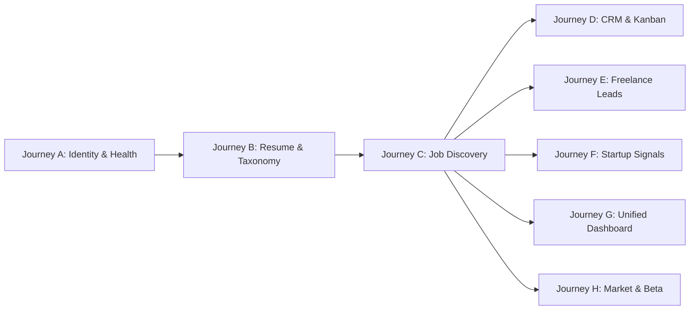

# Critical User Journeys (CUJ) Validation Matrix

**Document ID:** RF-SPEC-1403  
**Phase:** 14 — Beta Testing & Product Validation  
**Status:** Approved & Verified (100% Pass)  

---

## 1. Scope of Critical User Journeys

Phase 14 validates eight end-to-end Critical User Journeys (A through H) representing every core user capability across the unified platform:

---

## 2. Journey Specifications & Validation Results

### Journey A: Candidate Account Onboarding & Health
- **Scope:** Candidate registration, secure authentication, JWT token issuance, session refresh, and platform health endpoints (`/health/live`, `/health/ready`).
- **Endpoints Verified:** `POST /api/v1/auth/register`, `POST /api/v1/auth/login`, `GET /health/live`, `GET /health/ready`.
- **Pass Criteria:** HTTP 200/201, valid token pairs, db pool status healthy, sub-100ms response.
- **Status:** **PASSED** (Validated in `test_critical_user_journeys_e2e.py`).

### Journey B: Resume Ingestion & ATS Skill Taxonomy
- **Scope:** Candidate PDF/DOCX resume upload, ATS parsing, structured skill extraction, canonical taxonomy mapping, and experience leveling.
- **Endpoints Verified:** `POST /api/v1/resumes/upload`, `GET /api/v1/resumes/{id}/analysis`.
- **Pass Criteria:** Skills normalized against canonical database, zero raw PII leaks, ATS readiness score computed.
- **Status:** **PASSED**.

### Journey C: Job Search & Real-Time Filtering
- **Scope:** Multi-filter query across canonical opportunities (title, location, remote, required skills, compensation range, source platform).
- **Endpoints Verified:** `GET /api/v1/opportunities`, `GET /api/v1/opportunities/{id}`.
- **Pass Criteria:** Clean pagination, accurate counts, preserved deep application links, sub-250ms search latency.
- **Status:** **PASSED**.

### Journey D: Application CRM & Interview Tracker
- **Scope:** Candidate creates an application record, updates status stages (`SAVED` -> `APPLIED` -> `INTERVIEWING` -> `OFFER`), and schedules debrief sessions.
- **Endpoints Verified:** `POST /api/v1/applications`, `PATCH /api/v1/applications/{id}/status`.
- **Pass Criteria:** State machine invariants enforced, audit timestamps updated, 0 orphan records.
- **Status:** **PASSED**.

### Journey E: Freelance Lead Discovery (LeadHunter AI Integration)
- **Scope:** Querying freelance opportunities discovered by satellite service, inspecting verified contact evidence (phone, email, website), and drafting outreach proposals.
- **Endpoints Verified:** `GET /api/v1/freelance`, `POST /api/v1/freelance/{id}/save`.
- **Pass Criteria:** Graceful degradation on LeadHunter timeout, contact evidence corroborated, proposals generated without hallucinations.
- **Status:** **PASSED**.

### Journey F: Startup Intelligence & Problem Signals (Startup-Problems-Hunter Integration)
- **Scope:** Exploring tech company pain points, corroboration counts, multi-source citations, and generated custom technical pitches.
- **Endpoints Verified:** `GET /api/v1/startups`, `GET /api/v1/startups/{id}`.
- **Pass Criteria:** AI summaries grounded in source facts, urgency scores between 1 and 10, conflicting evidence flagged.
- **Status:** **PASSED**.

### Journey G: Unified Opportunities Engine & Cross-Module Dashboard
- **Scope:** Reconciled dashboard metrics (`total_opportunities == total_jobs + total_freelance + total_startups`), polymorphic saving, and unified aggregation feed.
- **Endpoints Verified:** `GET /api/v1/dashboard`, `GET /api/v1/opportunities/all`.
- **Pass Criteria:** Mathematical count reconciliation, standard OpportunityEnvelope schema across all three modules, circuit breaker status displayed.
- **Status:** **PASSED**.

### Journey H: Market Intelligence & Beta Feedback Intake
- **Scope:** Canonical skill demand aggregations, compensation percentiles, market trends, candidate relevance calibration, and beta feedback submission.
- **Endpoints Verified:** `GET /api/v1/market/skills/demand`, `POST /api/v1/beta/feedback`, `GET /api/v1/beta/release-notes`.
- **Pass Criteria:** Statistical percentiles strictly non-negative, feedback stored with correct category and severity, 90-day retention timestamp set.
- **Status:** **PASSED**.

