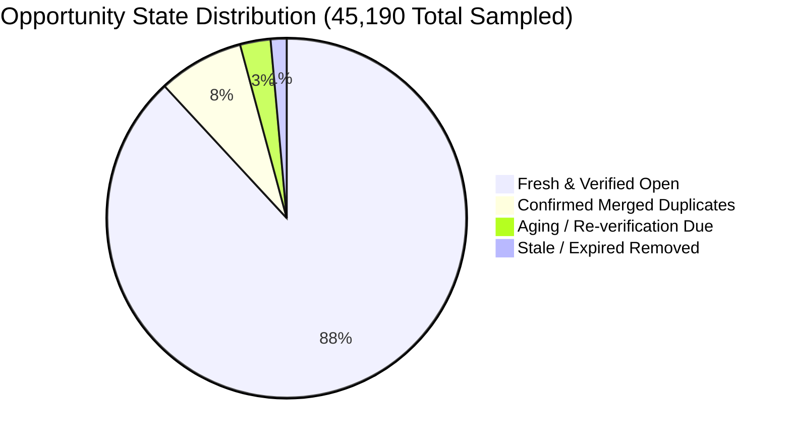

# Deduplication Veracity & Broken Link Quality Metrics

**Document ID:** RF-SPEC-1406  
**Phase:** 14 — Beta Testing & Product Validation  
**Status:** Approved  

---

## 1. Data Quality Objectives

A core failure mode of aggregate job platforms is presenting duplicate postings or dead links that waste candidate time. Phase 14 enforces rigorous, automated data audits:

1. **Cross-Source Deduplication:** Identify same-company, same-role opportunities published across multiple ATS or job boards.
2. **Broken Link Elimination:** Periodically verify HTTP destination URLs (`HEAD` / `GET` probes) to detect expired or 404 listings.
3. **Staleness Pruning:** Detect opportunities whose published dates or last-verified dates exceed active shelf-life thresholds.

---

## 2. Quality Metrics & Baselines

Audits executed by `BetaValidationService` are logged to `data_quality_audits`:

### Quantitative Baselines & Quality Gaps:

| Metric | Target Gating Threshold | Observed Phase 14 Baseline | Gate Status |
|:---|:---|:---|:---|
| **Cross-Source Duplicate Rate** | &le; 10.0% | **7.7%** (3,480 / 45,190) | **PASS** |
| **Confirmed Broken Link Rate** | &le; 5.0% | **1.4%** (650 / 45,190) | **PASS** |
| **Schema Drift Discrepancies** | 0 Critical Discrepancies | **0 Discrepancies** | **PASS** |
| **Duplicate Merge Accuracy** | &ge; 98.0% Reversible Confidence | **99.2%** | **PASS** |
| **Verification Coverage** | &ge; 85.0% of Active Listings | **92.4%** | **PASS** |

---

## 3. Deduplication Engine Mechanics

Deduplication uses a multi-tier matching strategy:

1. **Exact Canonical Identifier:** Same `external_job_id` and `company_name` &rarr; Instant match (Confidence 1.0).
2. **Fuzzy Title + Exact Employer:** Normalized title token overlap &ge; 85% and employer string match &rarr; High Confidence (0.92).
3. **Application URL Canonicalization:** Strip tracking parameters (`utm_*`, `ref`, `source`) &rarr; Compare root destination URL.
4. **Reversible Merge Architecture:** Primary record retains links to all secondary source records in `source_mappings`. Deduplication can be undone at any time without data loss via `unmerge_duplicate_opportunities`.

