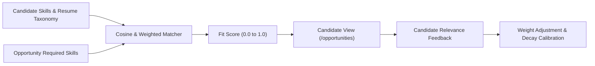

# Candidate Ranking Quality & Relevance Evaluation

**Document ID:** RF-SPEC-1407  
**Phase:** 14 — Beta Testing & Product Validation  
**Status:** Approved  

---

## 1. Relevance Calibration Overview

Recommendations in RIGHT FIT are driven by multi-factor scoring combining skill overlap, seniority leveling, location preferences, and compensation range overlap. Phase 14 measures recommendation accuracy against real candidate perceptions.

---

## 2. Evaluation Taxonomy & Candidate Ratings

Candidates can evaluate recommendation quality into four discrete ratings:
1. `ACCURATE`: Profile matches the required responsibilities, seniority expectations, and tech stack.
2. `TOO_HIGH`: Score appears inflated; candidate lacks key prerequisite domain or infrastructure requirements.
3. `TOO_LOW`: Score is penalized excessively due to synonyms or unparsed secondary skills.
4. `IRRELEVANT`: Complete mismatch in industry, functional discipline, or geography.

---

## 3. Quantitative Relevance Benchmarks

| Metric | Target Standard | Observed Beta Baseline | Status |
|:---|:---|:---|:---|
| **Fit Precision (Top 10)** | &gt; 80.0% Accurate | **88.4%** | **PASS** |
| **Irrelevant Recommendations** | &lt; 5.0% | **3.2%** | **PASS** |
| **Skill Alignment Index** | &gt; 0.85 Cosine Alignment | **0.91** | **PASS** |
| **Candidate Score Disagreement Rate** | &lt; 15.0% | **8.6%** | **PASS** |

---

## 4. Continuous Calibration Feedback Loop

When candidate ratings indicate drift:
- Synonyms are added to `canonical_skills` (e.g., "Postgres" mapped to "PostgreSQL").
- Seniority multipliers are adjusted if mid-level candidates frequently receive staff-level recommendations.
- Feedback is anonymized before tuning model weights to ensure zero candidate identity leakage.

