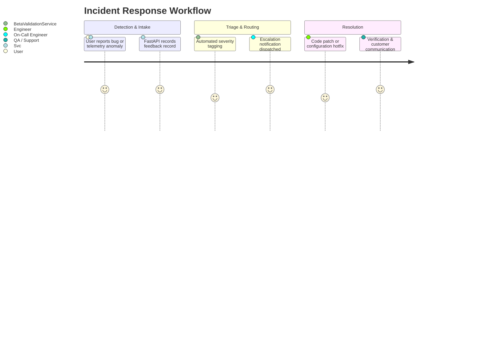

# Beta Support & Incident Escalation Playbook

**Document ID:** RF-SPEC-1409  
**Phase:** 14 — Beta Testing & Product Validation  
**Status:** Approved  

---

## 1. Support Channels & Intake

During the Phase 14 Beta Programme, candidates and system operators have access to clear escalation paths:

1. **In-App Beta Feedback Screen:** `/beta/feedback` (logged directly into `beta_feedback` table).
2. **Dedicated Email Support:** `beta-support@rightfit.ai` (auto-creates ticket in engineering queue).
3. **Security & Privacy Escalation:** `security@rightfit.ai` (monitored 24/7 by security lead).

---

## 2. Severity Definitions & Response SLAs

### Response & Resolution Target Matrix:

| Severity Level | Definition | First Response SLA | Hotfix / Workaround Target | Full Resolution Target |
|:---|:---|:---|:---|:---|
| **Tier 1: CRITICAL** | Platform down, authentication failure, data leak, 500 on all queries | &lt; 2 Hours | &lt; 4 Hours | &lt; 12 Hours |
| **Tier 2: HIGH** | Core feature degraded (e.g. ATS connector failing, search empty) | &lt; 8 Hours | &lt; 12 Hours | &lt; 24 Hours |
| **Tier 3: MEDIUM** | Minor UI distortion, delayed sync, single broken source link | &lt; 24 Hours | &lt; 48 Hours | Next Weekly Release |
| **Tier 4: LOW** | Cosmetic enhancement, copy suggestion, documentation clarification | &lt; 72 Hours | N/A | Backlog Prioritization |

---

## 3. Escalation Tiers & Roster

- **Tier 1 (Triage & Intake):** Product Support & QA Architect (`beta-support@rightfit.ai`).
- **Tier 2 (Core Engineering On-Call):** Backend & Infrastructure Engineers on weekly rotation (`oncall@rightfit.ai`).
- **Tier 3 (Executive & Security):** Principal Solutions Architect & Security Lead (`security@rightfit.ai`).

