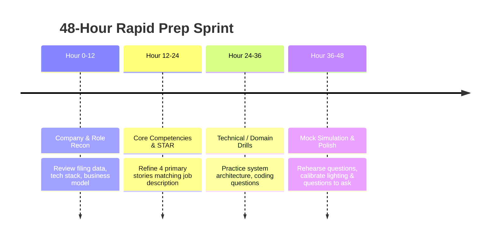

# 48-Hour Rapid Preparation Sprint Mode

## Overview
Candidates often receive last-minute interview invitations. The **48-Hour Rapid Preparation Sprint** synthesizes verified job requirements, candidate resume evidence, company intelligence, and likely technical questions into an intensive, phased preparation timeline.

## Phased Sprint Timeline

## Generation Intelligence & Grounding Rules
1. **Resume Evidence Grounding**: The system never invents achievements. Every suggested STAR answer must cite verified bullet points from the candidate's active resume.
2. **Role Requirements Alignment**: Highlights must address explicit skills in the job specification.
3. **Company Intelligence**: Pulls company mission, recent news, business tier, and typical interview style.
4. **Questions to Ask**: Pre-generates high-leverage questions for the candidate to ask the interviewer.

## API Endpoint
- **POST `/api/v1/interview-intelligence/sprint-48h`**:
  - Request: `{ "application_id": "...", "round_type": "TECHNICAL", "time_remaining_hours": 48 }`
  - Returns structured preparation schedule with checklist milestones and time allocations.

