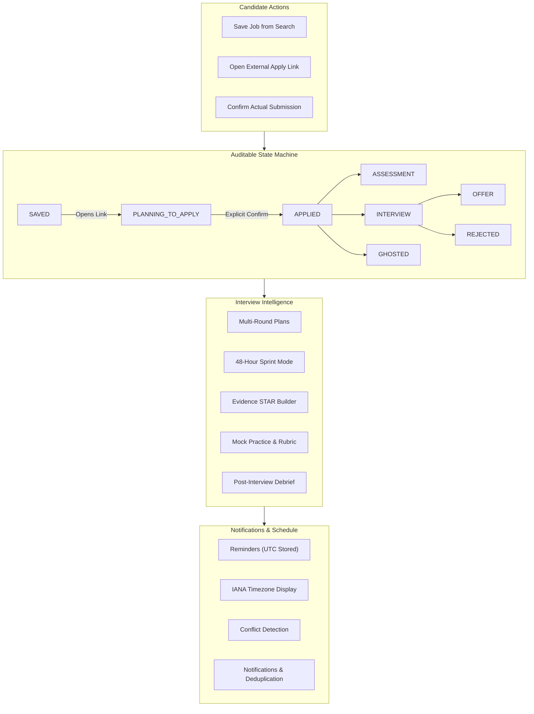

# Phase 8 — CRM and Interview Intelligence Architecture

## 1. Executive Summary

Phase 8 of **RIGHT FIT** introduces two core intelligence capabilities:
1. **Application CRM & Candidate Pipeline Management**: An auditable, state-machine governed tracking system for candidate job applications, with explicit external link opening tracking, mandatory candidate submission confirmation, status change audit trails, private encrypted candidate notes, and real-time pipeline funnel metrics.
2. **Interview Intelligence Hub**: A comprehensive interview lifecycle accelerator offering multi-round interview plans, dynamic 48-Hour Sprint Preparation Mode, evidence-grounded STAR Answer Builder with missing metrics detection, interactive practice mock sessions evaluated by a transparent 6-factor rubric, schedule conflict detection with IANA timezone conversions, post-interview debriefs, and an intelligent notification delivery engine with category-level preferences and duplicate suppression.

---

## 2. Architecture & Service Boundaries

Following the approved Hybrid Architecture (Option A):
- **Core Career Engine Ownership**: Core owns all canonical opportunities, candidate identities, application records, interview plans, rounds, STAR answer banks, mock sessions, debriefs, reminders, and notifications.
- **REST Contract Separation**: Clean decoupling between frontend interfaces (`/applications`, `/calendar`, `/interview-prep`, `/notifications`) and Core REST API endpoints (`/api/v1/applications`, `/api/v1/reminders`, `/api/v1/interview-plans`, `/api/v1/notifications`).
- **Zero Hallucination Guarantee**: The interview preparation engine anchors behavioral stories and study topics strictly in confirmed candidate resume/profile evidence and canonical job requirements. It never invents employer materials or fabricated achievements.
- **External Apply Link Semantics**: Clicking an apply link tracks `apply_link_opened_at` and moves applications from `SAVED` to `PLANNING_TO_APPLY`. It **never** marks an application as `APPLIED` without explicit candidate confirmation.

---

## 3. Workstreams Overview

---

## 4. Documentation Index

1. [Application State Machine](application-state-machine.md)
2. [Save & Apply Tracking Semantics](save-and-apply-tracking.md)
3. [Status History Audit Trail & Private Notes](status-history-and-notes.md)
4. [CRM Dashboard & Pipeline Metrics](crm-dashboard-and-metrics.md)
5. [Reminders & IANA Timezone Standardization](reminders-and-timezone.md)
6. [Interview Plans & Multi-Round Management](interview-plans-and-rounds.md)
7. [48-Hour Sprint Preparation Mode](48-hour-preparation-mode.md)
8. [STAR Answer Builder & Evidence Grounding](star-answer-builder.md)
9. [Mock Interview Practice & 6-Factor Rubric](mock-interview-and-rubric.md)
10. [Interview Debrief & Schedule Conflicts](interview-debrief-and-conflicts.md)
11. [Notifications Engine & Category Preferences](notifications-and-preferences.md)

