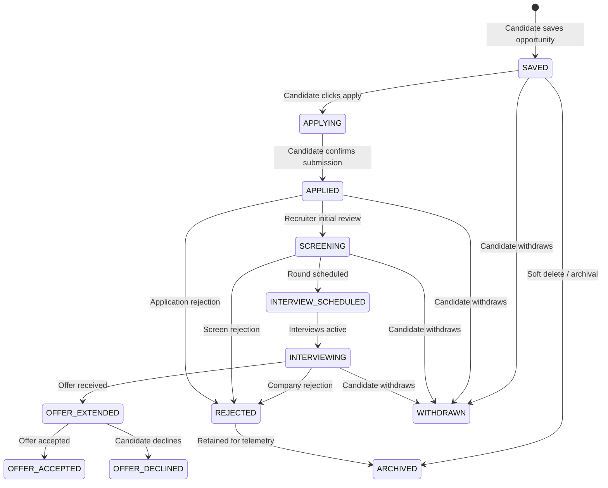

# Application State Machine & Transition Rules

## Overview
RIGHT FIT implements a deterministic, candidate-centric Application State Machine. Every job application record transitions through validated operational states with full auditability, explicit confirmation gates, and immutable status history logs.

## Supported Application States



### Enumeration of States (`ApplicationStatus`)
1. **`SAVED`**: The opportunity is bookmarked in the candidate's CRM. Default state upon initial entry.
2. **`APPLYING`**: Candidate is actively filling out the external/ATS application.
3. **`APPLIED`**: Candidate explicitly confirms that the application has been submitted to the employer.
4. **`SCREENING`**: Recruiter phone screen, recruiter review, or automated evaluation.
5. **`INTERVIEW_SCHEDULED`**: At least one formal interview round has been booked on the calendar.
6. **`INTERVIEWING`**: Technical, behavioral, panel, or executive interview rounds are underway.
7. **`OFFER_EXTENDED`**: Formal offer received with compensation, terms, and deadline.
8. **`OFFER_ACCEPTED`**: Candidate accepted the employment offer.
9. **`OFFER_DECLINED`**: Candidate declined the employment offer.
10. **`REJECTED`**: Application was rejected at any stage (reasons optionally tagged).
11. **`WITHDRAWN`**: Candidate explicitly withdrew application from consideration.
12. **`ARCHIVED`**: Candidate archived the record to keep CRM active view clean.

## Transition Rules & Validation Gateways

### 1. Mandatory Explicit Confirmation for `APPLIED`
- Transition from `SAVED` or `APPLYING` to `APPLIED` requires `applied_at` timestamp.
- System never automatically assumes submission merely because an outbound apply URL was opened.

### 2. Transition Gateways
- Terminal states: `OFFER_ACCEPTED`, `OFFER_DECLINED`, `ARCHIVED`.
- Backward transitions are guarded: candidates may return from `APPLIED` to `APPLYING` if submission failed or requires correction.
- Status history is append-only in `application_status_history` table.

## Data Model & Schema
```python
class ApplicationRecord(Base):
    __tablename__ = "applications"
    id = Column(String(36), primary_key=True)
    candidate_id = Column(String(36), ForeignKey("candidate_profiles.id"), nullable=False)
    canonical_opportunity_id = Column(String(36), ForeignKey("canonical_opportunities.id"), nullable=True)
    company_name = Column(String(255), nullable=False)
    job_title = Column(String(255), nullable=False)
    status = Column(String(32), default="SAVED", nullable=False)
    applied_at = Column(DateTime(timezone=True), nullable=True)
    last_status_change_at = Column(DateTime(timezone=True), default=utc_now, nullable=False)
```

