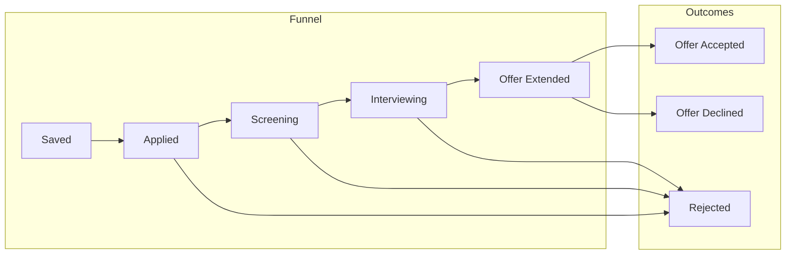

# CRM Dashboard & Pipeline Metrics

## Overview
The CRM Dashboard provides candidates with an actionable command center to visualize pipeline velocity, response rates, upcoming interview milestones, and application funnel health.

## Metrics Engine

### Pipeline Funnel KPIs
- **Total Applications**: Lifetime sum of opportunities moved past `SAVED`.
- **Active Pipeline**: Count of applications in `[APPLIED, SCREENING, INTERVIEW_SCHEDULED, INTERVIEWING]`.
- **Response Rate**: Percentage of `APPLIED` submissions that reached `SCREENING` or `INTERVIEWING`.
- **Offer Rate**: Percentage of interviewed candidates that received `OFFER_EXTENDED`.
- **Average Velocity (Days to Response)**: Mean elapsed days between `applied_at` and first recruiter interaction.



## API Endpoint
- **GET `/api/v1/applications/metrics`**: Computes aggregated pipeline metrics dynamically for the authenticated candidate profile.
- **Query Parameters**:
  - `start_date`: Optional ISO filter
  - `end_date`: Optional ISO filter
- **Response Schema**:
  ```json
  {
    "total_applications": 24,
    "active_pipeline": 7,
    "interviews_scheduled": 3,
    "offers_extended": 1,
    "rejection_rate_percentage": 20.8,
    "response_rate_percentage": 41.6,
    "average_days_to_first_response": 8.4
  }
  ```

