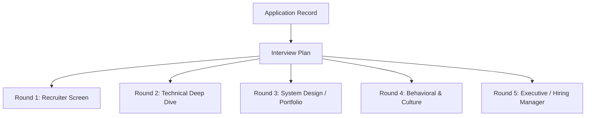

# Interview Plans & Round Architecture

## Overview
Interview processes consist of multiple rounds with varying objectives, formats, and evaluators. RIGHT FIT organizes candidate interview preparation into an `InterviewPlan` containing ordered `InterviewRound` entities.

## Interview Plan Structure



## Round Types & Attributes
- **Round Categories**:
  - `SCREENING`: Initial recruiter call, 30 min.
  - `TECHNICAL`: Coding, system architecture, pair programming.
  - `BEHAVIORAL`: STAR leadership, conflict resolution, values alignment.
  - `CASE_STUDY`: Take-home challenge or live presentation.
  - `PANEL`: Multi-interviewer consensus session.
  - `EXECUTIVE`: Founder / VP fit and compensation alignment.

## Data Models

```python
class InterviewPlanRecord(Base):
    __tablename__ = "interview_plans"
    id = Column(String(36), primary_key=True)
    candidate_id = Column(String(36), ForeignKey("candidate_profiles.id"), nullable=False)
    application_id = Column(String(36), ForeignKey("applications.id", ondelete="CASCADE"), nullable=False)
    target_role = Column(String(255), nullable=False)
    company_name = Column(String(255), nullable=False)
    preparation_strategy = Column(Text, nullable=True)
    status = Column(String(32), default="ACTIVE", nullable=False)

class InterviewRoundRecord(Base):
    __tablename__ = "interview_rounds"
    id = Column(String(36), primary_key=True)
    plan_id = Column(String(36), ForeignKey("interview_plans.id", ondelete="CASCADE"), nullable=False)
    round_number = Column(Integer, nullable=False)
    round_name = Column(String(128), nullable=False)
    round_type = Column(String(64), nullable=False)
    interviewer_names = Column(JSON, default=list)
    scheduled_at = Column(DateTime(timezone=True), nullable=True)
    duration_minutes = Column(Integer, default=60)
    focus_areas = Column(JSON, default=list)
    status = Column(String(32), default="SCHEDULED")
```

