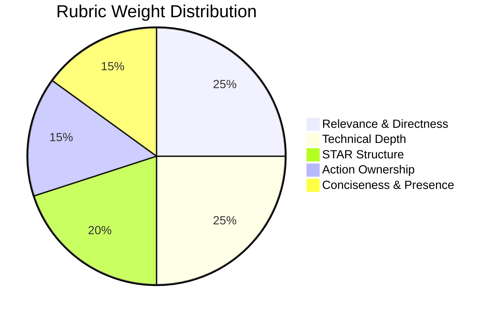

# Mock Interview Simulation & Evaluation Rubric

## Overview
RIGHT FIT provides interactive AI mock interview drills. The AI interviewer delivers authentic, role-specific questions and evaluates candidate answers against a transparent, multi-dimensional scoring rubric.

## Evaluation Rubric Dimensions
Every candidate response is scored across 5 objective dimensions on a 1–5 scale:

1. **Relevance & Directness (Weight: 25%)**:
   - Did the candidate directly answer the prompt without evasiveness?
2. **Technical Depth & Accuracy (Weight: 25%)**:
   - Are concepts, frameworks, trade-offs, and metrics accurately articulated?
3. **STAR Structure & Clarity (Weight: 20%)**:
   - Is there a clear Situation, Task, Action, and measurable Result?
4. **Action Ownership (Weight: 15%)**:
   - Did the candidate emphasize "I" vs generic "we" to demonstrate personal agency?
5. **Conciseness & Executive Presence (Weight: 15%)**:
   - Was the answer delivered within the target 2–3 minute window without filler?



## Data Models
```python
class MockInterviewSessionRecord(Base):
    __tablename__ = "mock_interview_sessions"
    id = Column(String(36), primary_key=True)
    candidate_id = Column(String(36), ForeignKey("candidate_profiles.id"), nullable=False)
    target_role = Column(String(255), nullable=False)
    interview_type = Column(String(64), nullable=False)  # BEHAVIORAL, TECHNICAL, SYSTEM_DESIGN
    overall_score = Column(Float, nullable=True)
    feedback_summary = Column(Text, nullable=True)
    status = Column(String(32), default="IN_PROGRESS")

class MockInterviewQuestionRecord(Base):
    __tablename__ = "mock_interview_questions"
    id = Column(String(36), primary_key=True)
    session_id = Column(String(36), ForeignKey("mock_interview_sessions.id", ondelete="CASCADE"), nullable=False)
    question_order = Column(Integer, nullable=False)
    question_text = Column(Text, nullable=False)
    candidate_answer = Column(Text, nullable=True)
    score = Column(Float, nullable=True)
    rubric_scores_json = Column(JSON, default=dict)
    feedback_text = Column(Text, nullable=True)
```

