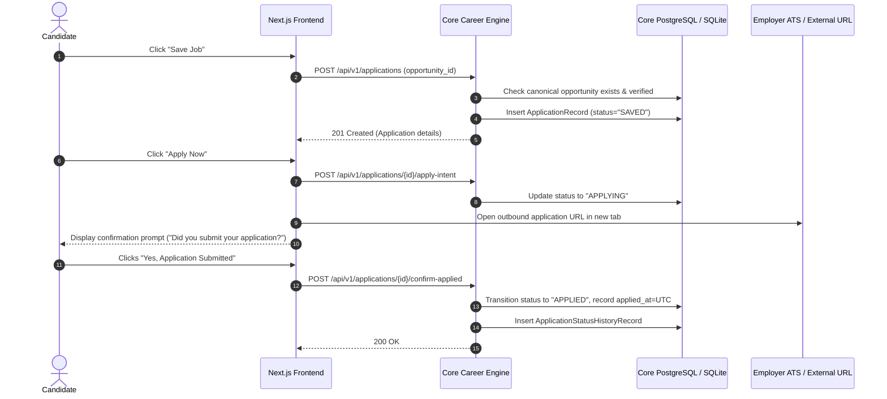

# Save and Apply Tracking

## Overview
RIGHT FIT provides friction-free transition from verified discovery to active pipeline management. Candidates can save opportunities with a single click and track the full external application lifecycle.

## Architectural Flow

## Key Capabilities
1. **Deduplication Check**: Ensures candidate does not accidentally create duplicate active applications for the same canonical opportunity.
2. **Provenance Preservation**: Links application to source observation, ATS portal identifier, and original listing snapshot.
3. **Outbound Intent Logging**: Emits audit telemetry when candidate leaves the platform to submit on third-party ATS (Workday, Greenhouse, Lever, etc.).
4. **Offline / Custom Opportunity Support**: Allows candidate to manually log applications for private leads or unlisted positions (`canonical_opportunity_id` can be null).

