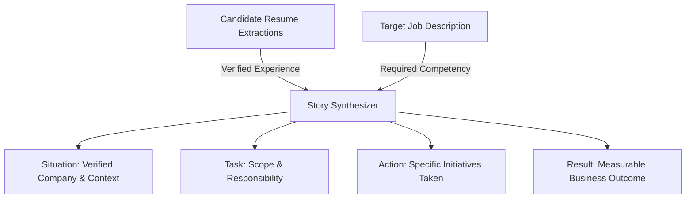

# STAR Answer Builder & Grounded Evidence

## Overview
The STAR method (Situation, Task, Action, Result) is the gold standard for behavioral interviews. RIGHT FIT assists candidates in structuring their authentic career accomplishments into compelling narratives while enforcing strict factual grounding against resume extractions.

## Anti-Hallucination & Evidence Grounding Rule
> **MANDATORY CORE STANDARD**: The system shall never fabricate career metrics, companies, titles, or achievements. Every generated or suggested story must link directly to an existing `ResumeExtraction` or `Experience` entity ID.



## Schema (`STARAnswerRecord`)
```python
class STARAnswerRecord(Base):
    __tablename__ = "star_answers"
    id = Column(String(36), primary_key=True)
    candidate_id = Column(String(36), ForeignKey("candidate_profiles.id"), nullable=False)
    competency = Column(String(128), nullable=False)  # e.g., "Conflict Resolution", "Scale"
    title = Column(String(255), nullable=False)
    situation = Column(Text, nullable=False)
    task = Column(Text, nullable=False)
    action = Column(Text, nullable=False)
    result = Column(Text, nullable=False)
    linked_experience_id = Column(String(36), ForeignKey("experiences.id"), nullable=True)
    target_job_roles = Column(JSON, default=list)
    tags = Column(JSON, default=list)
```

## Candidate Workflow in UI
1. Select target competency (Leadership, Technical Overhaul, Ambiguity).
2. Choose from candidate's verified work history experiences.
3. System structures the rough bullet points into draft S-T-A-R sections.
4. Candidate edits, practices, and tags the story for quick retrieval.

