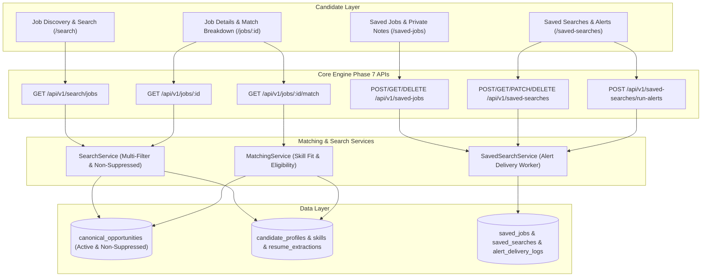

# RIGHT FIT — Phase 7: Job Search, Candidate Matching & Personalized Discovery

## 1. Overview & Objective

Phase 7 delivers a production-grade, candidate-facing career intelligence discovery experience. Powered by verified canonical opportunity records from Phases 5 & 6 and confirmed candidate resume evidence from Phases 3 & 4, Phase 7 enables candidate-controlled search and explainable matching.

### Core Architectural Guarantees
1. **Evidence-Based Matching**: Match scores evaluate exclusively against candidate-confirmed resume extractions and profile skills. The system strictly forbids hallucinating or inventing candidate qualifications.
2. **Dimension Independence**: Skill fit is evaluated and presented **completely separately** from mandatory eligibility (legal/education/location constraints) and verification trust/freshness.
3. **No False Rejections on Missing Profile Data**: When a candidate has not entered education or experience records, mandatory eligibility evaluates to `UNKNOWN` (never `DOES_NOT_MEET_REQUIREMENTS`).
4. **Source Coverage & Partial Results Transparency**: Upstream source connector outages or circuit breaker trips are surfaced directly to candidates via coverage metadata, distinguishing zero market listings from upstream aggregator downtime.
5. **Idempotent Alert Cadence**: Automated alert subscriptions track timestamp watermarks (`last_notified_at`) and audit logs to prevent duplicate email or in-app notification spam.

---

## 2. Phase 7 Architecture Map

---

## 3. Deliverables Summary

| Deliverable | Location | Status |
| :--- | :--- | :--- |
| **Contracts & Schemas** | `contracts/matching/schemas.py` | `ACTIVE CONTRACT` |
| **Database Models** | `backend/app/db/models.py` (`saved_jobs`, `saved_searches`, `alert_delivery_logs`) | `MIGRATED` |
| **Skill Fit & Eligibility Engine** | `backend/app/services/matching_service.py` | `VERIFIED` |
| **Search & Coverage Service** | `backend/app/services/search_service.py` | `VERIFIED` |
| **Saved Searches & Alert Runner** | `backend/app/services/saved_search_service.py` | `VERIFIED` |
| **REST Endpoints** | `backend/app/api/v1/endpoints/matching.py` | `VERIFIED` |
| **Search UI Page** | `frontend/src/app/(dashboard)/search/page.tsx` | `COMPILED` |
| **Job Detail & Match Breakdown** | `frontend/src/app/(dashboard)/jobs/[jobId]/page.tsx` | `COMPILED` |
| **Saved Jobs Management** | `frontend/src/app/(dashboard)/saved-jobs/page.tsx` | `COMPILED` |
| **Alerts Management** | `frontend/src/app/(dashboard)/saved-searches/page.tsx` | `COMPILED` |
| **Automated Tests** | `backend/tests/unit/` & `backend/tests/integration/` | `15 / 15 PASSED` |

