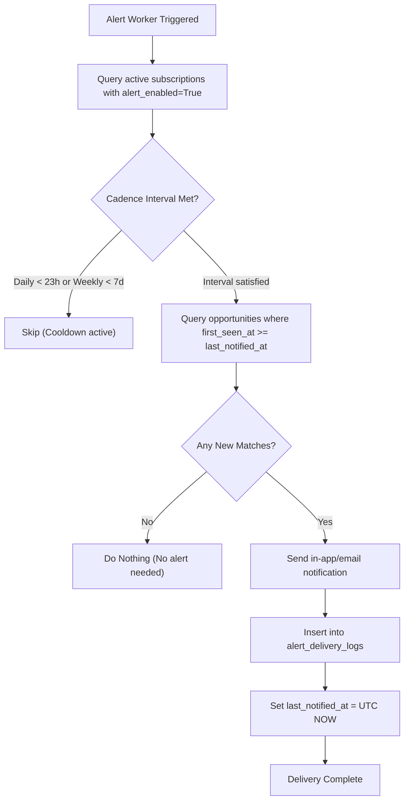

# Alert Delivery Worker & Idempotency Governance

## 1. Anti-Spam & Delivery Idempotency

Background alert evaluation workers must never flood candidates with repeated notifications for the same job openings.

### Idempotency Mechanics
1. **Timestamp Watermarking**: Each subscription maintains a timezone-aware UTC `last_notified_at` field.
2. **First-Seen Horizon**: When querying candidate matches, the worker only inspects canonical listings where:
   $$\text{first\_seen\_at} \ge \text{last\_notified\_at}$$
3. **Audit Log Recording**: Every alert transmission creates an immutable record in `alert_delivery_logs` capturing:
   - `saved_search_id`
   - `user_id`
   - `opportunity_ids_json`
   - `delivery_channel` (`IN_APP` or `EMAIL`)
   - `delivered_at`
   - `status` (`DELIVERED` or `FAILED`)

---

## 2. Cadence Rules

---

## 3. Empty Results Handling

If a saved search produces zero newly ingested matches since the last notification, the system records no delivery and sends no notification, ensuring candidates only receive high-signal updates.

