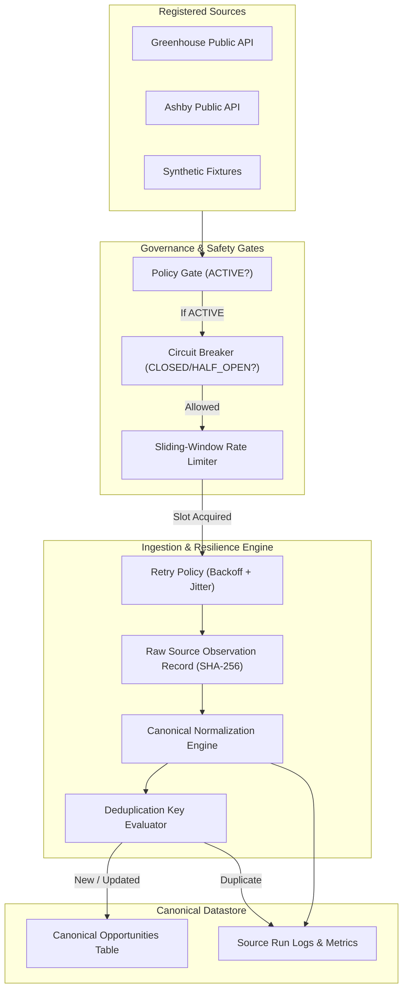

# Job Source Framework — Overview

**Phase:** 5 — Job Source Framework: Registry, Connectors, Normalization & Provenance  
**Status:** IMPLEMENTED & TESTED  
**Version:** 1.0.0  

---

## 1. Executive Summary

The **Job Source Framework** is the canonical data ingestion and governance backbone of the **RIGHT FIT Career Intelligence Platform**.

Prior to Phase 5, the legacy codebases contained ad-hoc, brittle scraping scripts across diverse ATS platforms without rate limit quotas, error recovery, or provenance auditing. Phase 5 establishes an enterprise-grade, extensible framework that strictly enforces:
- **Zero Restricted Scraping:** Exclusive reliance on documented, permitted public REST/JSON APIs (e.g. Greenhouse public board API, Ashby public posting API).
- **Governance Policy Gating:** Strict administrative lifecycle status (`DRAFT`, `PENDING_REVIEW`, `APPROVED`, `ACTIVE`, `PAUSED`, `BLOCKED`, `RETIRED`). Ingestion is rejected by default unless the source is explicitly transitioned to `ACTIVE`.
- **Resilience Engine:** 3-state Circuit Breaker (`CLOSED`, `OPEN`, `HALF_OPEN`), per-source sliding-window rate limiting, and exponential backoff retries with randomized jitter.
- **Auditable Provenance:** Every listing maintains raw source observations, cryptographic payload hashes (SHA-256), and timestamps (`first_seen_at`, `last_seen_at`, `source_published_at`).
- **Grounded Normalization:** Canonical transformation strictly forbids fabricating compensation estimates or artificial job requirements.
- **Cross-Source Deduplication:** Stable deterministic hashing prevents duplicate listings across boards and runs.

---

## 2. Directory & Component Organization

| Path | Purpose |
|---|---|
| `contracts/sources/` | Pydantic v2 data contracts for registry, observations, canonical opportunities, and run logs. |
| `backend/app/db/models.py` | SQLAlchemy ORM models: `JobSourceRecord`, `SourceObservationRecord`, `CanonicalOpportunityRecord`, `SourceRunLogRecord`. |
| `backend/app/services/resilience.py` | 3-state Circuit Breaker, sliding-window rate limiter, and retry policy with jitter. |
| `backend/app/services/connectors/` | Connector interface (`BaseJobConnector`), Greenhouse adapter, Ashby adapter, Synthetic adapter, and provider registry. |
| `backend/app/services/normalization_service.py` | HTML tag scrubbing, workplace classification, un-fabricated salary parsing, skills extraction, and SHA-256 dedup keys. |
| `backend/app/services/source_service.py` | Administrative CRUD, configuration updates, and policy review audit trail. |
| `backend/app/services/ingestion_service.py` | End-to-end ingestion pipeline orchestrator enforcing all gates. |
| `backend/app/api/v1/endpoints/sources.py` | REST API routes for source management, ingestion triggers, run logs, observations, and opportunities discovery. |
| `frontend/src/app/(dashboard)/sources/` | Next.js source registry and details management dashboard. |
| `frontend/src/app/(dashboard)/opportunities/` | Search, filtering, and discovery UI for canonical opportunities. |
