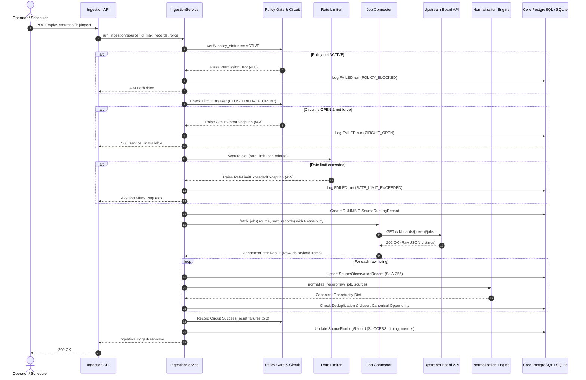

# Ingestion Lifecycle & Resilience Architecture

**Phase:** 5 — Job Source Framework: Registry, Connectors, Normalization & Provenance  
**Status:** IMPLEMENTED & TESTED  
**Version:** 1.0.0  

---

## 1. Overview

The ingestion lifecycle coordinates external data retrieval, resilience mechanisms, provenance tracking, and data deduplication. Ingestion is triggered either manually on-demand (via REST API) or systematically via background jobs.

---

## 2. 3-State Circuit Breaker State Transitions

Implemented in `backend/app/services/resilience.py`:

| Current State | Event | Condition | Next State | Action |
|---|---|---|---|---|
| `CLOSED` | Success | Operation completes cleanly | `CLOSED` | `consecutive_failures = 0` |
| `CLOSED` | Transient Error | Consecutive failures < `threshold` (default 3) | `CLOSED` | Increment `consecutive_failures` |
| `CLOSED` | Transient Error | Consecutive failures >= `threshold` (3) | `OPEN` | Set `cooldown_until = now() + 60s` |
| `OPEN` | Check | `now() < cooldown_until` | `OPEN` | Block execution; raise `CircuitOpenException` |
| `OPEN` | Check | `now() >= cooldown_until` | `HALF_OPEN` | Allow single trial execution |
| `HALF_OPEN` | Success | Trial execution succeeds | `CLOSED` | Reset `consecutive_failures = 0`, clear cooldown |
| `HALF_OPEN` | Failure | Trial execution fails | `OPEN` | Trip immediately back to `OPEN`, reset cooldown |

---

## 3. Retry Policy with Exponential Backoff & Jitter

When querying upstream APIs, transient network errors, socket timeouts, and HTTP 429/5xx responses are retried using exponential backoff with randomized jitter:

$$\text{delay} = \min\left(\text{max\_delay}, \text{base\_delay} \times \text{factor}^{\text{attempt}}\right) + \text{uniform}(0, 0.25 \times \text{delay})$$

- **Non-transient errors:** HTTP 400 (Bad Request), 401 (Unauthorized), 403 (Forbidden), 404 (Not Found), and validation errors are **never retried**. They fail fast to prevent resource wastage.

