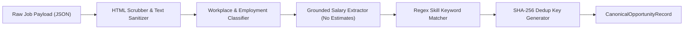

# Canonical Opportunity Normalization

**Phase:** 5 — Job Source Framework: Registry, Connectors, Normalization & Provenance  
**Status:** IMPLEMENTED & TESTED  
**Version:** 1.0.0  

---

## 1. Normalization Pipeline Overview

The **Normalization Service** (`backend/app/services/normalization_service.py`) converts raw payloads from diverse ATS systems (Greenhouse, Ashby, etc.) into the platform's canonical schema (`CanonicalOpportunityRecord`).

---

## 2. Transformation Stages

### 1. HTML Scrubbing & Entity Resolution
- Replaces block-level HTML tags (`
`, `
`, ` `, `<li>`, `<h1>`-`<h6>`) with clean paragraph and list breaks.
- Strips remaining tags (`<script>`, ``, `<strong>`, `<a>`, etc.) without leaving stray brackets.
- Resolves all HTML entities (`&amp;`, `&nbsp;`, `&lt;`, `&gt;`, `&#39;`).
- Normalizes multiple blank lines and whitespace sequences into readable markdown-like plain text.

### 2. Workplace & Remote Classification
- Checks provider explicit flags (`isRemote: true`).
- Evaluates title, location, and description against standardized keywords:
  - `REMOTE`, `is_remote = True`: matches `remote`, `work from home`, `wfh`, `anywhere`, `telecommute`.
  - `HYBRID`, `is_remote = False`: matches `hybrid`, `flexible`.
  - `ON_SITE`, `is_remote = False`: matches `on-site`, `onsite`, `in-person`, `in-office`.
  - `UNKNOWN`, `is_remote = False`: fallback when unspecified.

### 3. Grounded Compensation Rule (Anti-Hallucination)
- **Strict Policy:** RIGHT FIT strictly prohibits inventing, imputing, or fabricating candidate salary estimates.
- If explicit numerical compensation is present in the feed (e.g. Ashby compensation tier, Greenhouse structured salary), `min_salary`, `max_salary`, `currency`, and `salary_period` are captured, and `is_salary_estimated` is set to `False`.
- If no numerical compensation is declared by the employer, `min_salary` and `max_salary` remain `None`, and `is_salary_estimated` remains `False`.

### 4. Technical Skills Identification
- Uses boundary-aware regex (`\b<skill>\b`) against a curated library of known technologies (Python, FastAPI, TypeScript, React, Docker, Kubernetes, PostgreSQL, etc.).
- Produces a deduplicated, sorted list of verified technical skills mentioned in the job description.

---

## 3. Stable Deduplication Hashing

Cross-source deduplication is accomplished via a deterministic SHA-256 hash:

$$\text{dedup\_key} = \text{SHA256}(\text{normalized\_company} \mathbin{\Vert} \text{"|"} \mathbin{\Vert} \text{normalized\_title} \mathbin{\Vert} \text{"|"} \mathbin{\Vert} \text{normalized\_location})$$

Where each component is stripped, lowercased, and collapsed of extra whitespace. This guarantees that a job cross-posted across multiple boards (e.g. Greenhouse and Ashby simultaneously) maps to the same identity key, allowing duplicate suppression during ingestion.
