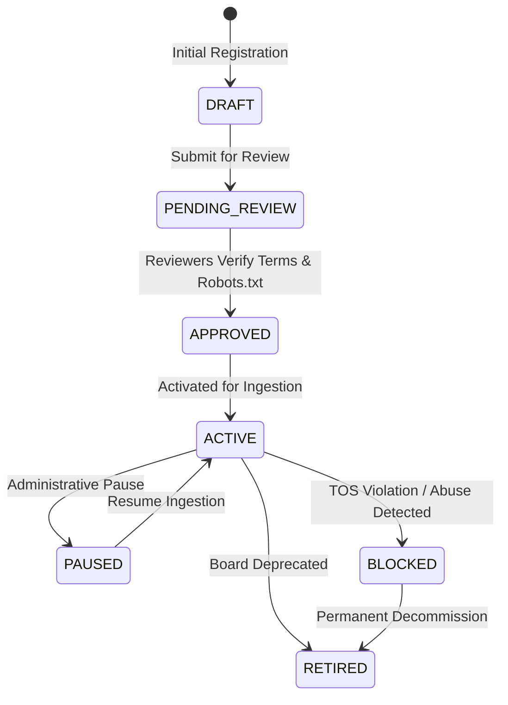

# Source Governance Policy Gate

**Phase:** 5 — Job Source Framework: Registry, Connectors, Normalization & Provenance  
**Status:** IMPLEMENTED & TESTED  
**Version:** 1.0.0  

---

## 1. Governance Lifecycle State Machine

To prevent unauthorized data ingestion, legal compliance issues, or accidental scraping of unpermitted targets, every opportunity source is subject to a strict 7-state governance lifecycle:



### State Definitions
1. **`DRAFT` (Initial Default):** Source has been created by an operator or integration engineer. Ingestion is strictly blocked.
2. **`PENDING_REVIEW`:** Submitted to security, legal, or compliance for robots.txt, terms of service, and rate quota review.
3. **`APPROVED`:** Compliance team has signed off on the feed. Configuration is locked; awaiting activation.
4. **`ACTIVE`:** Operational. Scheduled or manual ingestion runs are permitted.
5. **`PAUSED`:** Temporarily silenced by operators during site maintenance or ATS migration.
6. **`BLOCKED`:** Prohibited due to compliance flags, bot blocks, or upstream terms changes.
7. **`RETIRED`:** Permanently decommissioned feed.

---

## 2. Ingestion Policy Gate Enforcement

The policy gate is enforced as the very first step in `IngestionService.run_ingestion(...)`:

```python
if source.policy_status != PolicyStatus.ACTIVE.value:
    run_log = SourceRunLogRecord(
        source_id=source.id,
        trigger_type=trigger_type,
        status=RunStatus.FAILED.value,
        error_category="POLICY_BLOCKED",
        safe_error_summary=(
            f"Policy gate rejection: Source '{source.source_key}' has status '{source.policy_status}'. "
            f"Only ACTIVE sources are permitted to ingest."
        ),
        started_at=utc_now(),
        completed_at=utc_now(),
    )
    db.add(run_log)
    await db.commit()
    raise PermissionError(run_log.safe_error_summary)
```

Any attempt to ingest a `DRAFT`, `PENDING_REVIEW`, `PAUSED`, `BLOCKED`, or `RETIRED` source is halted immediately, returning HTTP 403 Forbidden with an auditable run log entry.

---

## 3. Auditable Decision Trail (`policy_decision_json`)

Every state transition requires an audit rationale and reviewer email. The decision history is appended to `policy_decision_json` on the `job_sources` table:

```json
{
  "latest_review": {
    "status": "ACTIVE",
    "reviewed_at": "2026-10-31T02:00:00Z",
    "reviewer_email": "compliance.officer@rightfit.platform",
    "notes": "Reviewed Greenhouse terms and verified public API license. Approved for 60 req/min."
  },
  "history": [
    {
      "from_status": "DRAFT",
      "to_status": "PENDING_REVIEW",
      "changed_at": "2026-10-31T01:30:00Z",
      "reviewer_email": "admin@rightfit.platform",
      "review_notes": "Submitted for legal review."
    },
    {
      "from_status": "PENDING_REVIEW",
      "to_status": "ACTIVE",
      "changed_at": "2026-10-31T02:00:00Z",
      "reviewer_email": "compliance.officer@rightfit.platform",
      "review_notes": "Reviewed Greenhouse terms and verified public API license. Approved for 60 req/min."
    }
  ]
}
```
