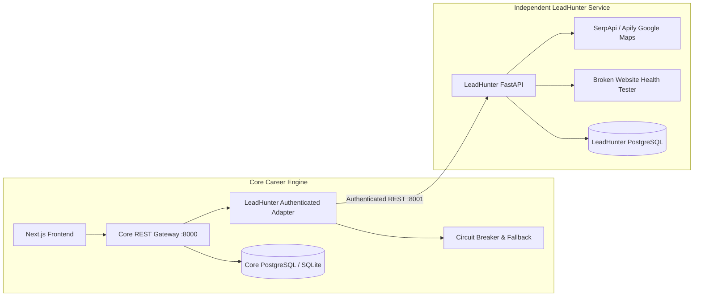

# Phase 9: LeadHunter Integration & Freelance Opportunity Intelligence

## Overview
Phase 9 integrates the independent **LeadHunter AI** service into the **RIGHT FIT Career Intelligence Platform**. Following the approved Option A Hybrid Architecture, LeadHunter remains an autonomous satellite service exposing authenticated REST APIs, while Core Career Engine owns canonical freelance opportunity discovery, deduplication, contact evidence audit, and candidate-governed outreach drafting.

## Workstream Index
1. [LeadHunter API Audit](./leadhunter-api-audit.md)
2. [Versioned API Contract](./versioned-api-contract.md)
3. [Core Adapter Architecture](./core-adapter-architecture.md)
4. [Lead-to-Freelance Mapping](./lead-to-freelance-mapping.md)
5. [Contact Evidence and Provenance](./contact-evidence-and-provenance.md)
6. [Import and Deduplication](./import-and-deduplication.md)
7. [Outreach Approval Workflow](./outreach-approval-workflow.md)
8. [Provider Delivery Evidence](./provider-delivery-evidence.md)
9. [Suppression and Rate Limits](./suppression-and-rate-limits.md)
10. [Independent Deployment Guide](./independent-deployment-guide.md)
11. [Recovery and Troubleshooting](./recovery-and-troubleshooting.md)
12. [Freelance Frontend Guide](./freelance-frontend-guide.md)
13. [Security and Privacy Review](./security-and-privacy-review.md)

