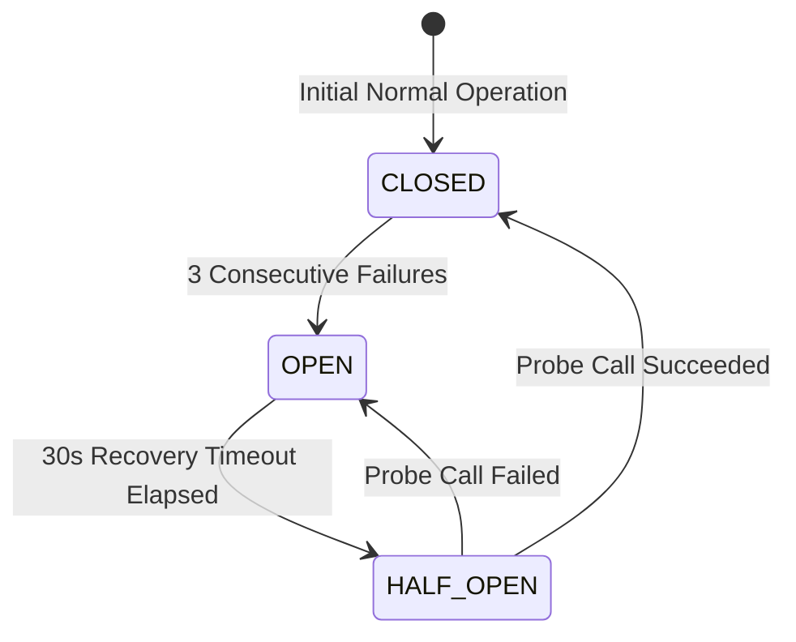

# Core Adapter Architecture & Resilience

## Overview
The `LeadHunterAdapter` in `app/integrations/leadhunter/adapter.py` acts as the single gateway for all Core requests to LeadHunter.

## Circuit Breaker State Machine

### Circuit States
1. **`CLOSED`**: Requests proceed directly to LeadHunter. Successful calls reset `failure_count` to 0.
2. **`OPEN`**: Tripped when 3 consecutive upstream requests fail (5xx error or connection timeout). Rejects subsequent calls immediately with `LeadHunterUnavailableError` without delaying user requests.
3. **`HALF_OPEN`**: After 30 seconds, a single test probe request is permitted through. If successful, circuit transitions back to `CLOSED`.

## Timeouts & Exponential Backoff
- Connection Timeout: 3.0 seconds
- Read/Response Timeout: 10.0 seconds
- Max Retries: 2 attempts on transient 5xx or connection errors with randomized jitter backoff (`(2^(attempt-1)) * 0.5 + jitter`).
- 4xx errors (client errors or auth failures) are never blindly retried.

