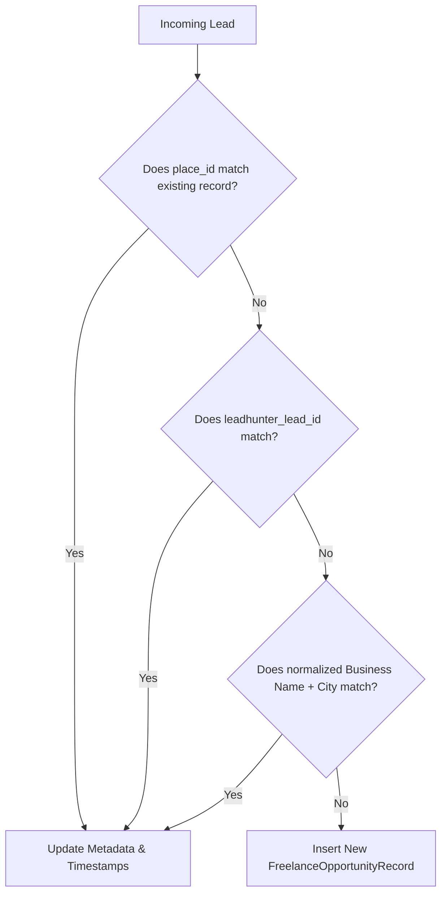

# Import and Multi-Signal Deduplication

## Overview
When LeadHunter returns batches of leads, Core performs idempotent import and deduplication to avoid creating duplicate opportunities.

## Multi-Signal Matching Sequence

## Update vs Insert Behavior
- **Match Found**: System refreshes `last_verified_at`, updates `is_broken_website`, and appends newly discovered contact channels to `contact_evidence` without replacing historical entries.
- **Ambiguous Match**: If business name matches but phone or website differs, classification is flagged as `REVIEW_REQUIRED`.

