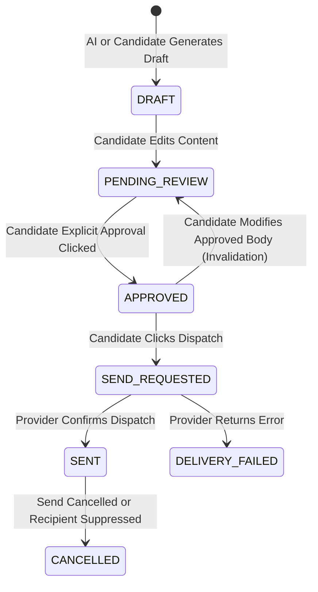

# Outreach Draft & Candidate Approval Workflow

## Overview
RIGHT FIT enforces strict candidate-level governance over all prospective client communications. **No automated mass spam or silent outreach is technically permitted.**

## Approval State Machine

## Security & Anti-Tamper Protections
1. **Cryptographic Body Hash**:
   When a candidate approves a draft, Core computes:
   `approved_body_hash = sha256(message_body)`
2. **Pre-Send Verification**:
   Immediately before dispatching to the delivery provider, Core verifies that:
   `sha256(current_body) == approved_body_hash`
   If the body was modified after approval, the transaction is rejected with `PermissionError` and the draft reverts to `PENDING_REVIEW`.
3. **Mandatory Explicit Human Action**:
   Outreach can only be sent upon direct candidate trigger (`POST /api/v1/freelance/drafts/{id}/send`).

