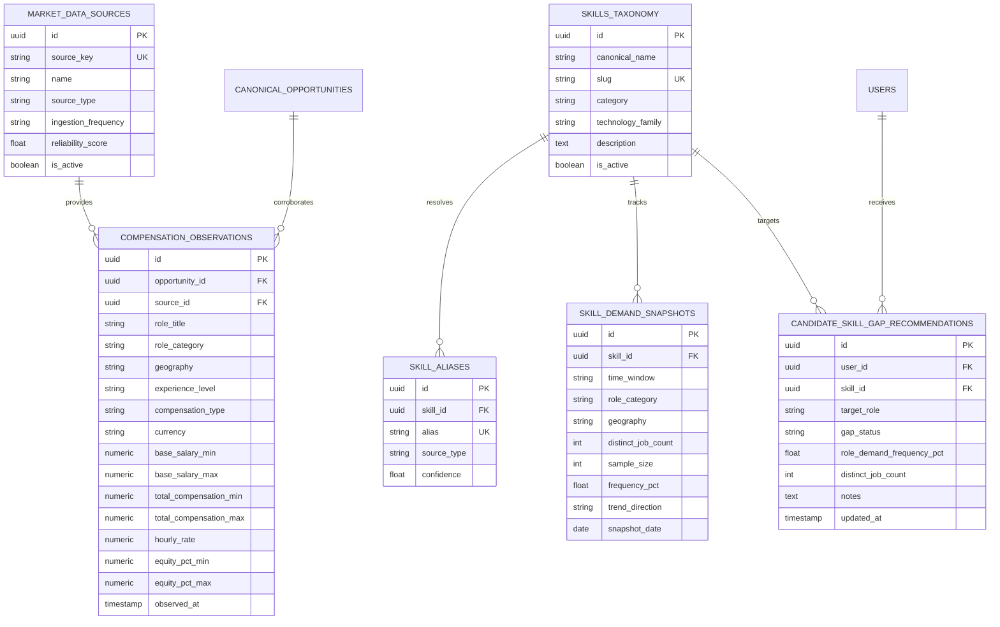

# Architecture: Market & Compensation Intelligence

## 1. System Context & Service Boundaries
The Market & Compensation Intelligence engine resides within the Core Career Engine of RIGHT FIT. It provides empirical macro intelligence across career markets without violating architectural domain boundaries:
- **Core Career Engine Ownership**: Core owns canonical opportunity vacancies (`canonical_opportunities`), candidate profiles (`users`, `resumes`), market data sources (`market_data_sources`), skill taxonomy (`skills_taxonomy`, `skill_aliases`), demand snapshots (`skill_demand_snapshots`), compensation records (`compensation_observations`), and candidate skill gap recommendations (`candidate_skill_gap_recommendations`).
- **Satellite Independence**: LeadHunter AI and Startup Intelligence feed their opportunities into the Core aggregation pipeline via standardized adapters. Market intelligence aggregates over verified canonical postings across these streams.
- **Data Stores**: All persistent entities reside in the Core PostgreSQL database across 6 dedicated relational tables, fully indexed on query dimensions (slugs, time windows, role categories, and user IDs).

## 2. Relational Schema Topology

## 3. Core Engine Components
1. **`MarketIntelligenceService`** (`backend/app/services/market_intelligence_service.py`):
   - Central orchestration service executing taxonomy lookups, deterministic alias mapping, distinct job vacancy counting, compensation percentiles calculation, and personalized skill-gap diagnostic generation.
2. **REST Endpoints Router** (`backend/app/api/v1/endpoints/market.py`):
   - High-performance, cached, and authenticated endpoints exposing market demand metrics, compensation benchmarks, and recommendation management.
3. **Next.js Frontend Architecture** (`frontend/src/app/(dashboard)/market-intelligence/*` & `/compensation`):
   - Responsive interfaces built with Tailwind CSS, supporting interactive time-window filters (`7d`, `30d`, `90d`), pay structure isolation toggles, and status progression controls.

