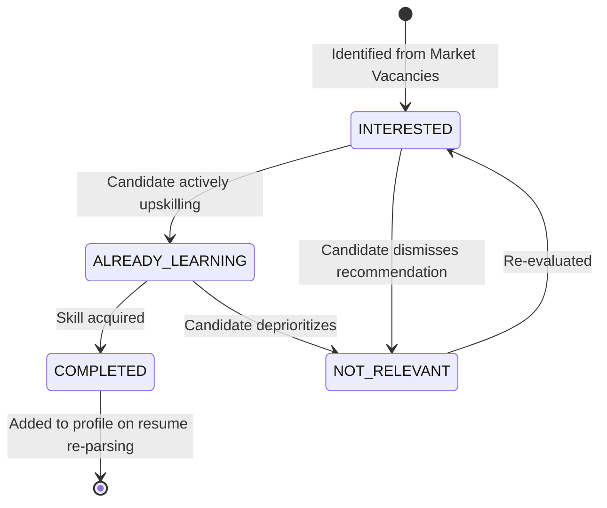

# Candidate Skill-Gap Engine

## 1. Objective & Alignment
The Candidate Skill-Gap Engine bridges market demand data with individual candidate qualification profiles. Rather than providing generic learning advice, it pinpoints the specific skills required by live postings for a candidate's target role that are missing from their verified profile.

## 2. Recommendation Lifecycle & Data Model
Recommendations are stored in `candidate_skill_gap_recommendations`:
```sql
CREATE TABLE candidate_skill_gap_recommendations (
    id UUID PRIMARY KEY,
    user_id UUID NOT NULL REFERENCES users(id) ON DELETE CASCADE,
    skill_id UUID NOT NULL REFERENCES skills_taxonomy(id) ON DELETE CASCADE,
    target_role VARCHAR(128) NOT NULL,
    gap_status VARCHAR(64) DEFAULT 'INTERESTED',
    role_demand_frequency_pct FLOAT DEFAULT 0.0,
    distinct_job_count INTEGER DEFAULT 0,
    notes TEXT,
    created_at TIMESTAMP WITH TIME ZONE DEFAULT NOW(),
    updated_at TIMESTAMP WITH TIME ZONE DEFAULT NOW()
);
```

## 3. Status State Machine
Candidates control their skill development roadmap through an explicit state machine:


- **`INTERESTED`**: Default state upon detection. Indicates high market prevalence for target role.
- **`ALREADY_LEARNING`**: Candidate has acknowledged the gap and is actively engaging in study or project work.
- **`NOT_RELEVANT`**: Candidate explicitly rejects the suggestion (e.g. they do not wish to specialize in that tool).
- **`COMPLETED`**: Candidate has satisfied the learning goal.

## 4. Grounding in Confirmed Resume Evidence
- Confirmed candidate skills are retrieved directly from Phase 4 Resume Intelligence tables (`resume_skills` where `is_verified = true`) and candidate profile records.
- If a skill is already confirmed, it is **never** recommended as a gap.

