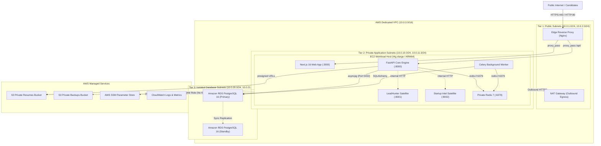

# Architecture: Production Cloud Infrastructure

## 1. System Overview & Deployment Topology
The production infrastructure for RIGHT FIT is designed according to **Option B: EC2 Container Workload Host + Amazon RDS PostgreSQL 16 Multi-AZ + Private Redis + Private S3 Object Storage**.

## 2. Structural Layer Boundaries
1. **Tier 1 (Public Subnets)**:
   - Contains edge Nginx reverse proxy listening on ports 80 and 443.
   - Contains NAT Gateway routing outbound requests (e.g. Gemini AI API calls, ATS scrapers) from private workloads to the internet.
   - No application databases or internal services reside here.
2. **Tier 2 (Private Application Subnets)**:
   - Houses the container compute instances.
   - All services execute within isolated Docker networks:
     - `rightfit-ingress-net`: Connected only to Nginx and Frontend.
     - `rightfit-internal-net`: Internal bridge for Backend, Worker, Redis, and satellite adapters.
   - Instances lack public IP addresses and can only be accessed via AWS Systems Manager.
3. **Tier 3 (Isolated Database Subnets)**:
   - Houses Amazon RDS PostgreSQL 16 Multi-AZ.
   - Subnets have **zero route table entries to the Internet Gateway or NAT Gateway**.
   - Database ingress is strictly filtered by security group to allow connections only from `sg_app` on port 5432.

