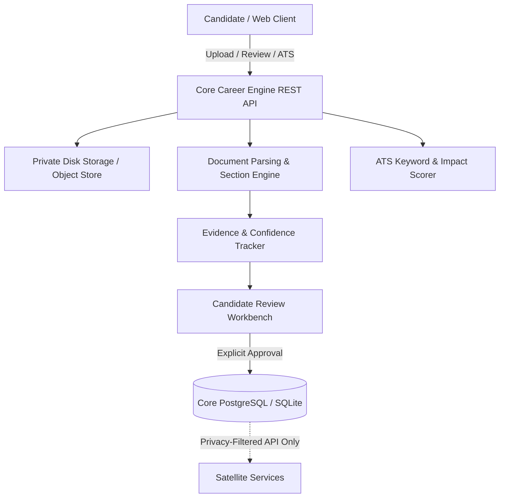

# Resume Intelligence & Reviewed Candidate Evidence

## 1. Overview & Architectural Objectives

The **Resume Intelligence** module in **RIGHT FIT** transforms uploaded candidate documents into structured, evidenced candidate records. Unlike naive resume text scrapers or generative rewrites that invent candidate qualifications, RIGHT FIT adheres to three non-negotiable architectural tenets:

1. **Evidence-Grounded Extraction**: Every extracted candidate fact (institution, degree, employer, title, bullet, or skill) is linked directly to an exact document excerpt, page citation, extraction method, and confidence score.
2. **Mandatory Candidate Review**: Unreviewed resume extractions are never treated as verified truth. Candidate profile synchronization requires explicit candidate consent, and existing user-provided profile data is strictly protected against accidental overwriting.
3. **No-Fabrication Policy**: Artificial intelligence models and analytical scorers must NEVER invent candidate facts, metrics, companies, or dates. Suggestions provided to candidates remain advisory, grounded, and human-in-the-loop (HITL).

---

## 2. Option A Hybrid Architecture Alignment

In accordance with RIGHT FIT's Hybrid Architecture:
- **Core Career Engine (`backend/`)**: Acts as the sole custodian of candidate resumes, parsed versions, evidence records, and candidate profile facts.
- **Satellite Services (`LeadHunter AI`, `Startup Problems Hunter`)**: Possess zero direct access to Core's candidate database or resume files.
- **Unified Frontend (`frontend/src/`)**: Communicates exclusively with Core via versioned REST contracts under `/api/v1/resumes`.

---

## 3. Subsystem Guide

| Subsystem | Documentation Guide |
|---|---|
| **Upload & Storage** | [upload-and-storage.md](upload-and-storage.md) — Magic byte validation, path traversal defense, isolated storage. |
| **Parsing Pipeline** | [parsing-pipeline.md](parsing-pipeline.md) — Multi-stage document parsing lifecycle and status state machine. |
| **Extraction & Evidence** | [extraction-and-evidence.md](extraction-and-evidence.md) — Section classification, entity extraction, and `EvidenceDTO` citations. |
| **Review & Correction** | [review-and-correction.md](review-and-correction.md) — Interactive candidate review, conflict detection, profile sync. |
| **Version Management** | [version-management.md](version-management.md) — Multi-version management, active version designation, history preservation. |
| **ATS Analysis** | [ats-analysis.md](ats-analysis.md) — Transparent keyword coverage, quantified bullet impact, no-fabrication advice. |
| **Data Retention & Privacy** | [../../privacy/resume-data-retention.md](../../privacy/resume-data-retention.md) — Secure deletion, storage scrubbing, GDPR/CCPA export. |
| **API Reference** | [../../api/resume-apis.md](../../api/resume-apis.md) — Complete REST endpoint specifications. |
| **Testing & Regression** | [../../testing/resume-regression-tests.md](../../testing/resume-regression-tests.md) — Synthetic fixtures and automated test reports. |

