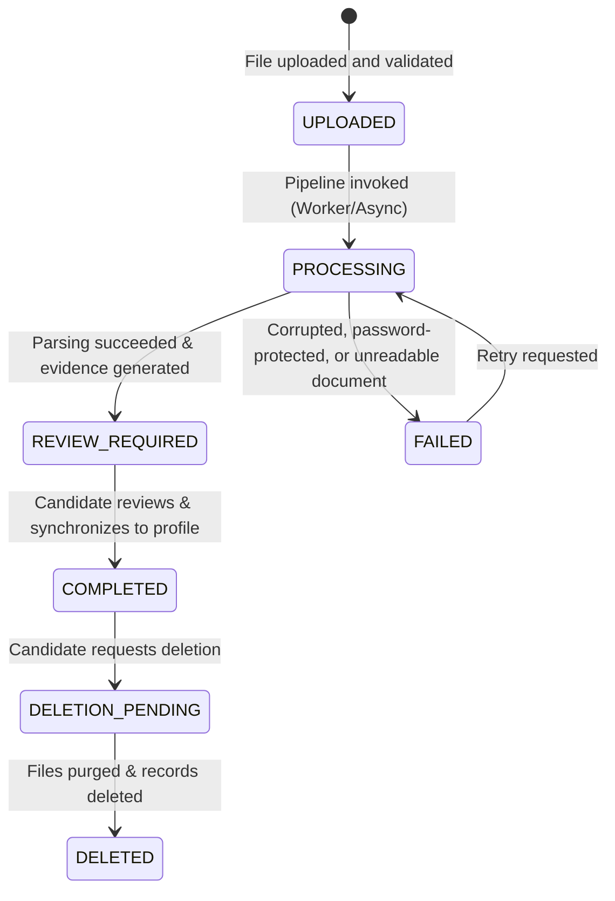

# Resume Parsing Pipeline & Task Lifecycle

## 1. Overview

The **Resume Parsing Pipeline** translates binary PDF and DOCX documents into clean structured candidate entities. The pipeline is designed to be asynchronous, idempotent, and fault-tolerant, providing real-time visibility into parsing stages without blocking candidate HTTP requests.

---

## 2. State Machine (`ParsingStatus`)

Every resume version progresses through a formal state machine:

### State Definitions

| State | Description | Next Allowed States |
|---|---|---|
| `UPLOADED` | File received, validated, and safely persisted. Not yet parsed. | `PROCESSING`, `DELETED` |
| `QUEUED` | Task dispatched to Redis background worker queue. | `PROCESSING`, `FAILED` |
| `PROCESSING` | Extractor active (text parsing, sectioning, entity extraction). | `REVIEW_REQUIRED`, `FAILED` |
| `REVIEW_REQUIRED` | Extraction finished with evidence items; awaiting candidate review. | `COMPLETED`, `PROCESSING` |
| `COMPLETED` | Candidate has reviewed and synchronized approved facts to profile. | `DELETION_PENDING`, `DELETED` |
| `FAILED` | Document unreadable, password-protected, or corrupted. | `PROCESSING`, `DELETED` |
| `DELETED` | Document and extracted records permanently removed. | `[*]` |

---

## 3. Pipeline Execution Stages

### Stage 1: Document Text & Page Partitioning
- **PDF Documents**: Handled via `fitz` (PyMuPDF). Reads pages sequentially, tracks page boundaries (`--- Page 1 ---`, `--- Page 2 ---`), and detects encrypted files.
- **DOCX Documents**: Handled via `docx` (`python-docx`). Extracts full paragraph text, runs, and structured table rows.

### Stage 2: Section Classification
Scans text lines against standardized header patterns:
- `SUMMARY`: "Professional Summary", "Executive Summary", "Summary", "Profile"
- `EXPERIENCE`: "Work Experience", "Professional Experience", "Employment History"
- `EDUCATION`: "Education", "Academic Background", "Academics", "Degrees"
- `SKILLS`: "Technical Skills", "Core Competencies", "Technologies"
- `PROJECTS`: "Key Projects", "Personal Projects", "Academic Projects"
- `CERTIFICATIONS`: "Certifications", "Licenses & Certifications", "Certificates"

### Stage 3: Entity Extraction & Evidence Association
- Extracts candidate name, email, phone, location, LinkedIn URL, GitHub URL, and portfolio link.
- Extracts institution names, degree titles, date ranges, and GPAs.
- Extracts companies, job titles, date ranges, and bullet points.
- Extracts categorized skills (Languages, Frameworks, Databases, Cloud, Tools, Soft Skills) using word boundary pattern matching.
- Generates an `EvidenceDTO` for every single extracted item.

### Stage 4: Review Workbench Initialization
- Creates a `ResumeReviewRecord` in PostgreSQL with all evidence items set to `review_status = "PENDING"`.
- Calculates conflict diffs against existing candidate profile fields.
- Sets version status to `REVIEW_REQUIRED`.

---

## 4. Recoverable Failure Handling

| Failure Scenario | Detection Mechanism | System Behavior |
|---|---|---|
| **Password Protected PDF** | `doc.is_encrypted` check in PyMuPDF | Marks status `FAILED` with message `"Password-protected PDF cannot be parsed. Please remove password encryption."` |
| **Corrupted Binary** | `fitz.FileDataError` / BadZipFile | Marks status `FAILED` with clean error description. No server crash. |
| **Scanned / Empty PDF** | Total extracted text length == 0 | Marks status `FAILED` with `"No extractable text found in document (may be scanned image or empty)."` |
| **Worker Timeout** | Task watchdog | Resets version to `FAILED` and allows safe candidate retry without creating duplicate records. |

