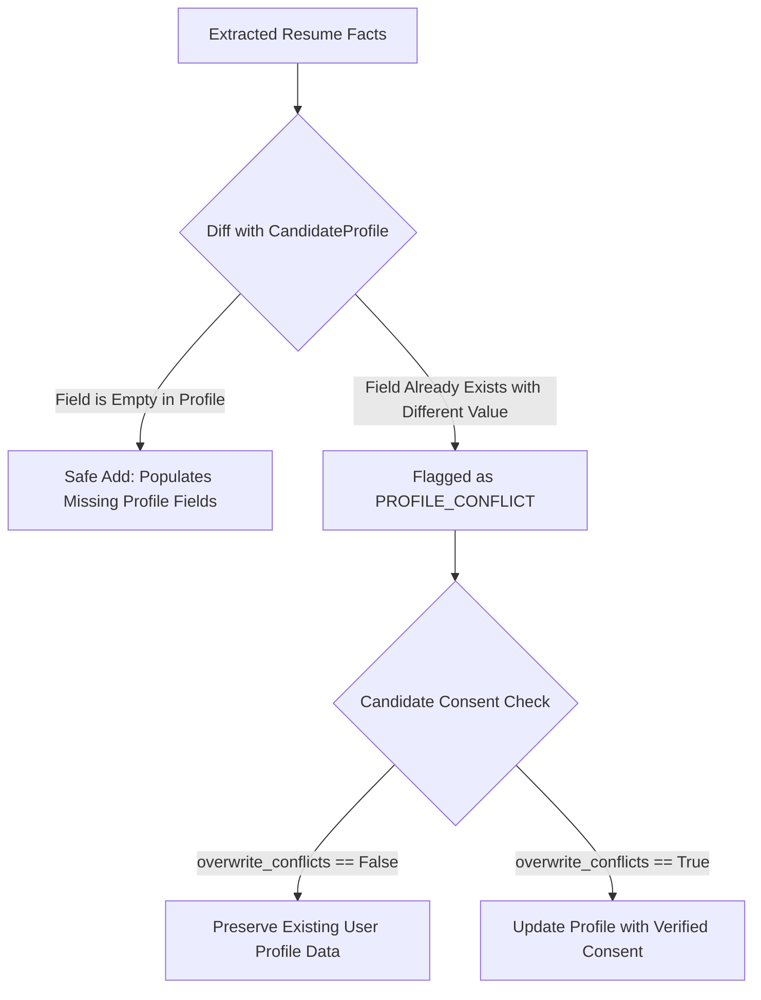

# Candidate Review Workbench & Profile Synchronization

## 1. Candidate Agency & HITL Principles

In **RIGHT FIT**, candidates retain absolute agency over their professional profiles. Automated extraction tools propose candidate data; only the candidate has the authority to approve, correct, or reject these proposals.

Unreviewed extracted facts are **never** treated as verified truth.

---

## 2. Review Actions

In the candidate review workbench (`/resumes/{resume_id}/review`), candidates can take four distinct actions on any evidenced field:

| Action | Meaning | Effect on Extraction | Effect on Profile |
|---|---|---|---|
| `CONFIRM` | Fact is accurate as extracted. | Marks `review_status = "CONFIRMED"`. | Eligible for profile synchronization. |
| `EDIT_AND_CONFIRM` | Extracted fact has typos or formatting errors. | Saves candidate-corrected value and marks `review_status = "EDITED"`. | Corrected value is synchronized with `USER_PROVIDED` provenance. |
| `REJECT` | Extracted fact is inaccurate or irrelevant. | Marks `review_status = "REJECTED"`. | Omitted from candidate profile synchronization. |
| `MARK_INCORRECT` | Extraction parser failed to capture meaning. | Marks `review_status = "REJECTED"`. | Excluded and flagged for telemetry improvement. |

---

## 3. Conflict Detection with Existing Profile

When a candidate uploads a new resume or version, the system evaluates conflicts between extracted information and existing canonical profile fields:



### Conflict Diff Example
If a candidate has existing profile phone `+1-555-010-0000` and uploads a resume listing `(555) 123-4567`:
```json
{
  "field_name": "phone",
  "current_profile_value": "+1-555-010-0000",
  "extracted_value": "(555) 123-4567",
  "description": "Phone number in resume differs from existing profile."
}
```

---

## 4. Profile Synchronization API

Synchronization is executed via `POST /api/v1/resumes/{resume_id}/confirm`:

### Request Payload (`ResumeConfirmSyncRequest`):
```json
{
  "approved_field_ids": null,
  "overwrite_conflicts": false
}
```

### Safety Rules:
1. **Non-Destructive by Default**:
   - If `overwrite_conflicts == False`, only empty profile fields are filled. Existing user-provided values remain 100% untouched.
2. **Explicit Candidate Consent**:
   - Overwriting existing facts requires setting `overwrite_conflicts == True`.
3. **Field Provenance Assignment**:
   - Synchronized facts receive `provenance = FieldProvenance.RESUME_EXTRACTED` (or `USER_PROVIDED` if the candidate edited the value).
4. **Audit Logging**:
   - Generates an immutable security audit event `PROFILE_SYNCED_FROM_RESUME` tracking synced count and conflict count.

