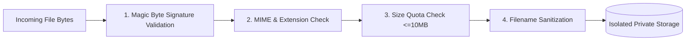

# Resume Upload & Secure Storage Architecture

## 1. Threat Model & Security Requirements

Resumes uploaded by public users present distinct cybersecurity attack surfaces:
1. **Malicious File Ingestion**: Upload of executables (`.exe`, `.dll`, `.sh`, `.bat`) disguised with deceptive file extensions (`resume.pdf.exe`).
2. **Path Traversal / Arbitrary File Overwrite**: Upload of filenames containing traversal sequences (`../../etc/passwd`, `..\..\Windows\system32`).
3. **Denial of Service (DoS)**: Ingestion of multi-gigabyte files or decompression bombs designed to exhaust disk and RAM.
4. **Data Exfiltration / Insecure Direct Object References (IDOR)**: Direct web exposure of resume files via public URLs or predictable storage keys.

---

## 2. Validation & Security Pipeline

The `StorageService` (`app/services/storage_service.py`) executes a 4-tier validation pipeline prior to persisting any file:



### 2.1 Magic Byte Signature Validation
Rather than trusting client-provided file extensions or `Content-Type` headers, the service inspects the leading file bytes:
- **PDF Documents**: Must start with `%PDF-` (`b"\x25\x50\x44\x46\x2D"`).
- **DOCX Documents**: Must start with OpenXML ZIP archive magic bytes `PK\x03\x04` (`b"\x50\x4B\x03\x04"`).
- Any document lacking valid magic signatures raises `StorageSecurityError` and is rejected with HTTP `400 Bad Request`.

### 2.2 Filename Sanitization & Path Traversal Defense
User filenames are sanitized using `os.path.basename` and regex scrubbing:
```python
clean = os.path.basename(filename or "resume.pdf")
clean = clean.replace("\x00", "").replace("..", "")
clean = _SAFE_FILENAME_RE.sub("_", clean)
```
Path resolution enforces that resolved absolute paths never escape the candidate's dedicated directory:
```python
if not str(target_path).startswith(str(user_dir)):
    raise StorageSecurityError("Access denied: File does not belong to candidate.")
```

### 2.3 Size Enforcement
- Maximum document size is strictly capped at **10 MB** (`MAX_RESUME_FILE_SIZE_BYTES`).
- Uploads exceeding this quota are rejected immediately before disk I/O.

---

## 3. Storage Hierarchy & Isolation

Files are organized in isolated per-candidate subdirectories:

```
storage/
└── resumes/
    └── {user_id}/
        ├── {version_1_uuid}.pdf
        └── {version_2_uuid}.docx
```

### Private Retrieval & No Public URLs
- **Zero Public Access**: Resume files are never placed inside frontend public asset roots or exposed to static web server routes.
- **Authenticated Streaming Download**: File retrieval requires authentication via `GET /api/v1/resumes/{resume_id}/download`. The endpoint derives the candidate identity from the cryptographic JWT, confirms ownership, and streams the raw bytes via `StreamingResponse`.

