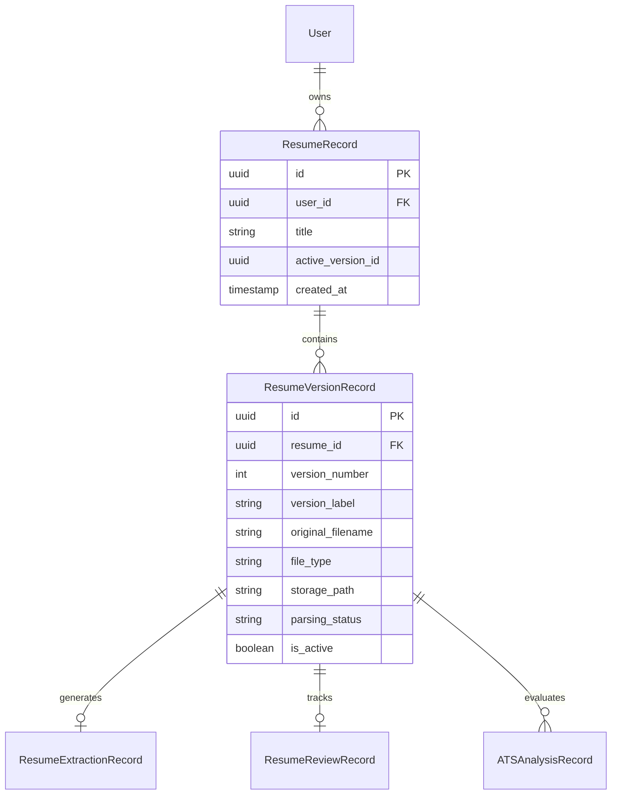

# Resume Version Management Architecture

## 1. Multi-Track Resume Workflows

In modern technology careers, candidates maintain multiple resume variants tailored to different roles (e.g., "Full-Stack Engineer", "Cloud & DevOps Architect", "Engineering Manager", "Internship").

In **RIGHT FIT**, candidates are never forced to overwrite their previous documents. The platform supports:
1. Multiple discrete resume containers (`ResumeRecord`).
2. An ordered lineage of versions within each resume (`ResumeVersionRecord`).

---

## 2. Relational Hierarchy

---

## 3. Version Lifecycle & Invariant Guarantees

1. **Non-Destructive Versioning**:
   - Uploading a new version (`POST /api/v1/resumes/{resume_id}/versions`) never overwrites or deletes previous version records or storage files.
   - Incrementing version numbers ($1 \to 2 \to 3$) ensures clear auditability.
2. **Failed Parse Isolation**:
   - A parsing failure on version $N$ does not invalidate or degrade a previously successful version $N-1$.
3. **Active Version Designation**:
   - A single version is marked `is_active = True` per resume container.
   - Candidates can toggle the active version at any time via `PATCH /api/v1/resumes/{resume_id}/active-version?version_id={version_id}`.
   - Satellite searches and outbound opportunity matching evaluate only the candidate's active version.
4. **Independent Extraction & Evidence**:
   - Each version retains its own `ResumeExtractionRecord` and `ResumeReviewRecord`. Differences in wording or formatting between versions remain traceable.

