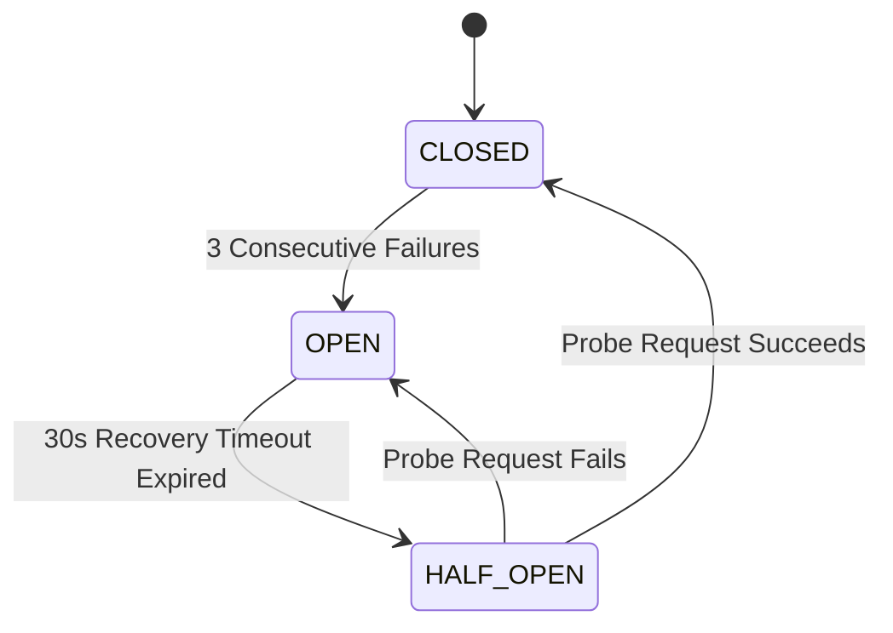

# Core Adapter Architecture & Circuit Breaker
## Workstream C Specification

- **Module:** `startup-intelligence`
- **Component:** `app.integrations.startup_intelligence.adapter.StartupIntelligenceAdapter`
- **Location:** `rightFIT/backend/app/integrations/startup_intelligence/adapter.py`

---

## 1. Architectural Role

The `StartupIntelligenceAdapter` serves as the resilient anti-corruption layer between RIGHT FIT Core and the independent `Startups-problrms-hunter` satellite service. It isolates Core from network instability, upstream service restarts, and slow scraper tasks.

```
+-------------------------------------------------------------+
|                     RIGHT FIT Core                          |
|  +--------------------+      +---------------------------+  |
|  |   StartupService   | <--> | StartupIntelligenceAdapter |  |
|  +--------------------+      +---------------------------+  |
+--------------------------------------------|----------------+
                                             | HTTP REST (:8002)
                                             v
+-------------------------------------------------------------+
|          Startups-problrms-hunter (Satellite Service)       |
|  +-------------+  +---------------+  +-------------------+  |
|  |  main.py    |  |  scraper.py   |  |   ai_agent.py     |  |
|  +-------------+  +---------------+  +-------------------+  |
|         |                                                   |
|         v                                                   |
|   data/leads.json (598 records)                             |
+-------------------------------------------------------------+
```

---

## 2. Circuit Breaker Specification

To protect Core from cascading failures, the adapter embeds a finite state machine:



### Parameters:
- `failure_threshold`: 3 consecutive failures (HTTP 5xx, connection refused, or timeouts).
- `recovery_timeout`: 30.0 seconds before testing recovery probe.
- `connect_timeout`: 3.0 seconds.
- `read_timeout`: 10.0 seconds.
- `max_retries`: 2 attempts with exponential backoff and jitter (`(2^(attempt - 1)) * 0.5 + uniform(0.1, 0.3)s`).

---

## 3. Graceful Degraded Mode

When the Circuit Breaker trips to `OPEN`, the adapter immediately fast-fails calls with `StartupIntelligenceUnavailableError`.

The REST API router (`/api/v1/startups/scan-leads`) catches this exception and returns a **200 OK Degraded Response Envelope**:
```json
{
  "success": true,
  "degraded": true,
  "message": "Startup Intelligence satellite service is currently offline or unreachable. Displaying cached Core opportunities.",
  "stats": {
    "imported_count": 0,
    "updated_count": 0,
    "skipped_count": 0,
    "total_processed": 0
  }
}
```

This guarantees:
1. Candidate job searching, applications, interview intelligence, and profile features remain 100% operational.
2. The UI renders an informative warning banner without crashing.
3. Previously imported startup opportunities remain fully browsable and bookmarkable from Core's database.

