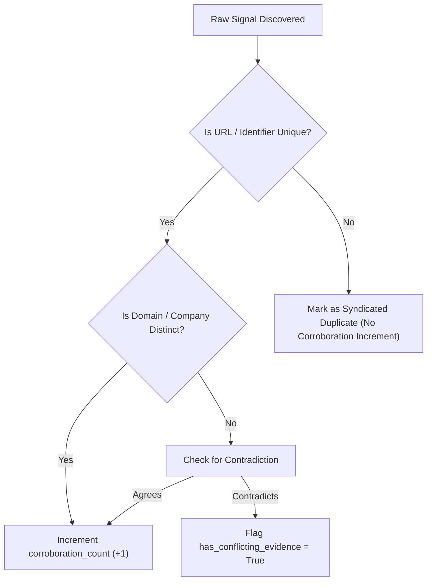

# Safe Deduplication & Corroboration Engine
## Workstream F Specification

- **Module:** `startup-intelligence`
- **Tables:** `startup_opportunities`, `startup_corroborations`

---

## 1. Multi-Signal Deduplication Hierarchy

Deduplication in Startup Intelligence uses a deterministic, tiered matching logic to prevent duplicate records while avoiding false merges across distinct startups:

1. **Tier 1 — Upstream Service Record ID Match**: If `service_record_id` matches an existing canonical record, the existing record is updated in place.
2. **Tier 2 — Domain & Category Match**: If `domain` is known and matches an existing record in the same `category`, observations are attached to the existing canonical record.
3. **Tier 3 — Startup Name & Signal Text Match**: If the startup name and verbatim problem title match, observations are merged.
4. **Different Startups Are Never Merged**: Startups are never merged merely because they share a category or discuss common libraries (e.g. Next.js).

---

## 2. Independent Corroboration vs. Syndication

The engine tracks how many independent sources report or corroborate the observation:

### Corroboration Rules:
1. **Syndication copies** (e.g., the same article reposted to multiple aggregators) are tagged `is_independent = False` and do NOT increment the corroboration score.
2. **Multiple independent platforms** (e.g. Reddit discussion + GitHub issue + PageSpeed audit) increment `corroboration_count`.
3. **Conflicting Signals**: If one source claims the website is fast while another notes latency, both observations are preserved, and `has_conflicting_evidence` is set to `True`.

