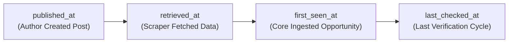

# Evidence Provenance & Timestamp Governance
## Workstream D Specification

- **Module:** `startup-intelligence`
- **Tables:** `startup_opportunities`, `startup_evidence`

---

## 1. Independent UTC Timestamp Dimensions

To prevent forensic errors where retrieval time overwrites original publication dates, Core maintains 4 distinct, timezone-aware UTC timestamps on every opportunity and evidence record:

### Definitions:
1. `published_at`: The exact timestamp when the author published the post, article, or GitHub issue. If missing from the upstream feed, Core explicitly displays: `"Publication date unavailable"`.
2. `retrieved_at`: The exact timestamp when the `Startups-problrms-hunter` scraper crawled the feed or website.
3. `first_seen_at`: The timestamp when RIGHT FIT Core first created the canonical record.
4. `last_checked_at`: The timestamp when RIGHT FIT Core last verified or refreshed the record against the satellite service.

---

## 2. Inaccessibility & Broken Link Preservation

When an original post or startup website is deleted, deleted from Reddit, or taken offline:
- The historical observation is retained in `startup_evidence`.
- The record status transitions to `UNAVAILABLE` or `ARCHIVED`.
- Core never fabricates replacement URLs or removes verified historical signals.

