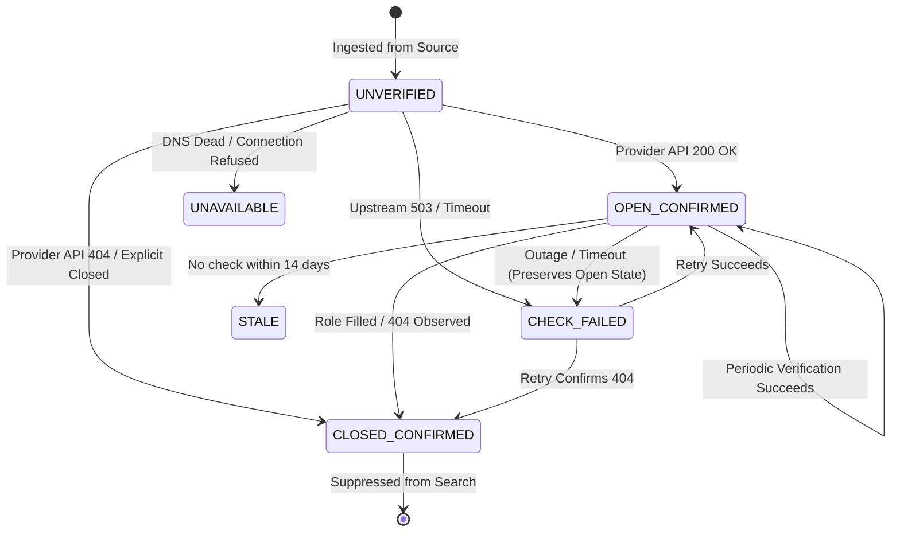

# Verification State Machine

## 1. Overview

RIGHT FIT enforces a formal verification state machine across all canonical opportunities. Unlike naive systems that treat a job listing as binary (open/closed), RIGHT FIT captures nuanced states representing uncertainty, upstream outages, and expiration.

---

## 2. Formal Verification States

| Status | Code | Description | Candidate Discovery |
|---|---|---|---|
| `UNVERIFIED` | Initial state upon ingestion | Listing ingested from a feed, but direct API or URL probe has not yet executed. | Visible |
| `OPEN_CONFIRMED` | Active & verified open | Upstream provider explicitly returned 200 OK or active status via direct API/probe. | Visible (Priority) |
| `CLOSED_CONFIRMED` | Active closed | Upstream provider returned 404/410 Not Found or explicit `status: closed`. | Suppressed |
| `EXPIRED_CONFIRMED`| Expired | Listing exceeded its explicit expiration deadline or passed provider cutoff. | Suppressed |
| `UNAVAILABLE` | Domain or network dead | DNS lookup failure, connection refused, or target website offline. | Suppressed |
| `CHECK_FAILED` | Verification error | 500/502/503 HTTP server error, timeout, or rate-limited during verification. | Preserves Prior Status |
| `AMBIGUOUS` | Indeterminate response | Landing page redirects to a generic careers homepage without requisition confirmation. | Visible (Annotated) |
| `STALE` | Check overdue | Listing has not been observed or verified within freshness policy threshold (>14d). | Visible (Annotated) |

---

## 3. State Transition Graph

---

## 4. Transition Invariants

1. **Outage Protection**: A transient 500, 502, or 503 HTTP status MUST NEVER transition an `OPEN_CONFIRMED` listing to `CLOSED_CONFIRMED`. It transitions to `CHECK_FAILED`, preserving candidate availability while scheduling retry.
2. **SSRF Guard**: Every URL probe must validate the resolved IP before opening a socket. Blocked addresses abort the verification immediately.
3. **Audit Trail**: Every state transition persists an immutable `VerificationEvidenceRecord`.

