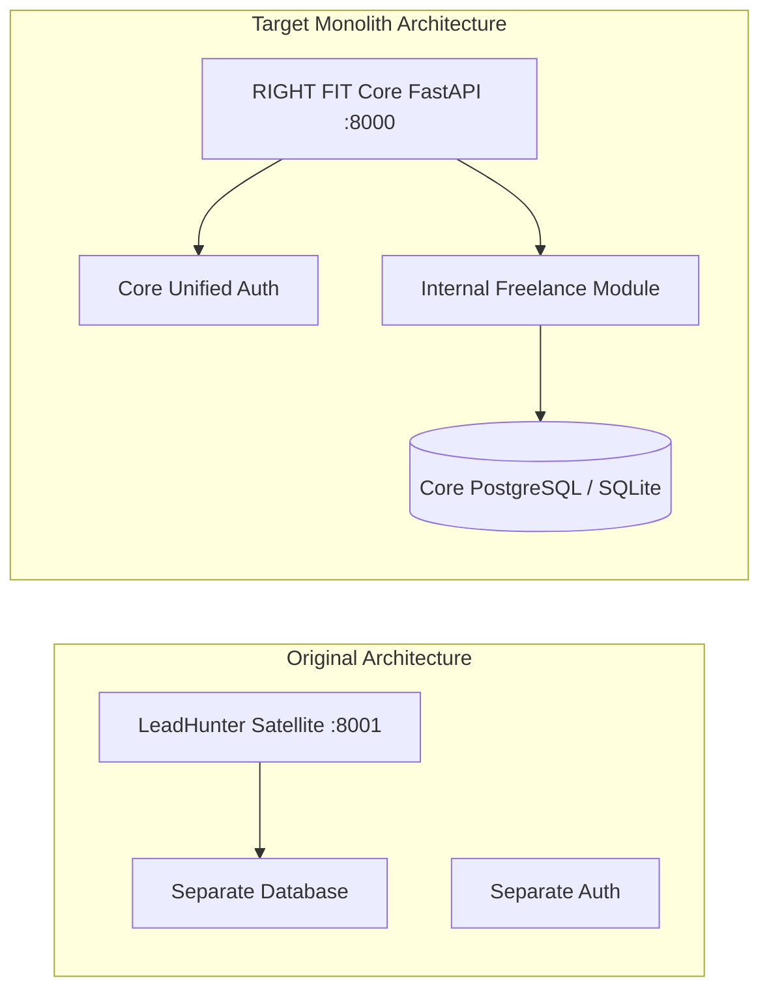

# LeadHunter Feature Mapping & Architecture Transition Matrix

**Project:** RIGHT FIT — Freelance Intelligence Integration  
**Date:** 2026-10-31  
**Status:** MAPPED  

---

## 1. Feature Transition Overview

This document details the functional mapping between LeadHunter capabilities and RIGHT FIT's unified **Freelance Intelligence module**. 

The migration converts LeadHunter from a loosely coupled satellite microservice communicating over HTTP (`http://localhost:8001`) into a native, high-performance internal Python domain module located within `backend/app/modules/freelance/`.

---

## 2. Comprehensive Feature Mapping Matrix

### A. Lead Discovery & Search

| LeadHunter Feature | Original Implementation | Target RIGHT FIT Architecture | Migration Status | Notes & Safeguards |
|:---|:---|:---|:---:|:---|
| **Google Maps Business Search** | `backend/collectors/serpapi_collector.py` | `app/modules/freelance/collectors/serpapi_collector.py` | **REUSE** | Preserves SerpApi query pagination, GPS `ll` coordinate extraction, and rate-limit backoff. |
| **Apify Maps Scraper Fallback** | `backend/collectors/apify_collector.py` | `app/modules/freelance/collectors/apify_collector.py` | **REUSE** | Secondary maps provider using Apify `compass/crawler-google-places` actor when SerpApi credits expire. |
| **Niche & City Search** | `backend/routes_fastapi/api_leads.py::search` | `app/api/v1/endpoints/freelance.py::search_leads` | **REWRITE** | Directly invokes internal discovery service instead of HTTP forwarding. |
| **Deep Scan & Zones** | `backend/services/search_service.py` | `app/modules/freelance/services/discovery_service.py` | **REWRITE** | Iterates through sub-zones in target metropolitan area to maximize unique discoveries. |
| **Configurable Result Limits** | `max_results` query parameter (1-100) | `LeadSearchRequest.max_results` (1-100) | **REUSE** | Enforced with Pydantic validation. |
| **Duplicate Search Prevention** | `SearchHistoryModel` table | `FreelanceSearchHistoryRecord` in Core DB | **REWRITE** | Stores query, city, results count, timestamp, and user ID. |

---

### B. Data Collection & Normalization

| LeadHunter Feature | Original Implementation | Target RIGHT FIT Architecture | Migration Status | Notes & Safeguards |
|:---|:---|:---:|:---:|:---|
| **Phone Number Standardization** | `DataCleaner.standardize_phone` via `phonenumbers` | `app/modules/freelance/utils/data_cleaner.py` | **REUSE** | Standardizes to international E.164 and local country codes (e.g., `+91 98765 43210`). |
| **Phone Classification (Mobile vs Landline)** | `phonenumbers.number_type` check | `DataCleaner.validate_and_classify_phone` | **REUSE** | Distinguishes WhatsApp-capable mobile lines from office landlines. |
| **Broken Website Detection** | `DataCleaner.check_website_health` | `app/modules/freelance/utils/data_cleaner.py` | **REUSE** | Fast HEAD probe followed by GET fallback; SSL errors classified as alive but unmaintained. |
| **SSRF-Protected Outbound Requests** | `utils/ssrf_guard.py` | `app/modules/freelance/utils/ssrf_guard.py` | **REUSE** | Blocks private, loopback, link-local, AWS/GCP metadata (`169.254.169.254`), and pins resolved IPs. |
| **Duplicate Lead Resolution** | `DataCleaner.remove_duplicates` | `app/services/freelance_service.py` (Multi-signal) | **REWRITE** | Multi-signal matching on `place_id`, `(business_name, city)`, and phone numbers. |

---

### C. Lead Enrichment & Technical Auditing

| LeadHunter Feature | Original Implementation | Target RIGHT FIT Architecture | Migration Status | Notes & Safeguards |
|:---|:---|:---:|:---:|:---|
| **Public Email Extraction** | `backend/utils/email_scraper.py` | `app/modules/freelance/utils/email_scraper.py` | **REWRITE** | Scrapes homepage and contact subpages; decodes obfuscated emails; enforces SSRF guard. |
| **Website Technical Audit** | `backend/utils/website_auditor.py` | `app/modules/freelance/utils/website_auditor.py` | **REUSE** | Computes 100-point scorecard: Speed, SEO title/meta, Mobile viewport, SSL configuration, Image alt tags. |
| **Visual Proof Mockup** | `backend/services/mockup_service.py` | `app/modules/freelance/services/mockup_service.py` | **REUSE** | Generates SVG preview mockup illustrating website redesign opportunities. |
| **Contact Evidence Ledger** | `ContactEvidenceRecord` in Core DB | `app/db/models.py::ContactEvidenceRecord` | **REUSE** | Retains provenance, discovered timestamp, and verification status for every contact channel. |

---

### D. Lead Qualification & Scoring

| LeadHunter Feature | Original Implementation | Target RIGHT FIT Architecture | Migration Status | Notes & Safeguards |
|:---|:---|:---:|:---:|:---|
| **Priority Classification** | `DataCleaner.assign_priority` (HIGH/MED/LOW/IGNORE) | `app/modules/freelance/utils/data_cleaner.py` | **REUSE** | Prioritizes businesses lacking websites or having broken websites with high customer review volume. |
| **Opportunity Synthesis** | `FreelanceService.map_lead_to_opportunity_fields` | `app/services/freelance_service.py` | **REUSE** | Maps leads into actionable opportunities (e.g., "Website Restoration & Modern Redesign"). |
| **Relevance Scoring** | Float metric (0-100) | `FreelanceOpportunityRecord.relevance_score` | **REUSE** | Transparent inputs: presence/absence of website, technical breakage, Google rating. |

---

### E. AI Pitch Generation

| LeadHunter Feature | Original Implementation | Target RIGHT FIT Architecture | Migration Status | Notes & Safeguards |
|:---|:---|:---:|:---:|:---|
| **PAS (Problem-Agitation-Solution) Framework** | `AIOutreachWriter.generate_pitch` | `app/modules/freelance/utils/ai_writer.py` | **REUSE** | Generates high-converting pitches for businesses with broken websites. |
| **BAB (Before-After-Bridge) Framework** | `AIOutreachWriter.generate_pitch` | `app/modules/freelance/utils/ai_writer.py` | **REUSE** | Generates growth-focused pitches for businesses lacking websites entirely. |
| **Prompt Template YAML** | `backend/prompts/outreach_pitches.yaml` | `app/modules/freelance/prompts/outreach_pitches.yaml` | **REUSE** | Hot-reloading YAML templates with strict anti-hallucination rules and banned buzzwords. |
| **Prompt Injection Defense** | `sanitize_prompt_input` in `ai_writer.py` | `app/modules/freelance/utils/ai_writer.py` | **REUSE** | Strips system overrides, HTML comments, and zero-width unicode characters. |
| **Tone & Length Customization** | Casual, Direct, Formal; Short, Punchy, Detailed | `GeneratePitchRequest` schema | **REUSE** | Configurable via API and UI. |

---

### F. Outreach & Governance

| LeadHunter Feature | Original Implementation | Target RIGHT FIT Architecture | Migration Status | Notes & Safeguards |
|:---|:---|:---:|:---:|:---|
| **Mandatory Candidate Approval** | Core `OutreachDraftRecord.is_approved` | `app/db/models.py::OutreachDraftRecord` | **REUSE** | Zero auto-send. System requires explicit user approval before message transmission. |
| **Edit Invalidation** | Core `FreelanceService.update_outreach_draft` | `app/services/freelance_service.py` | **REUSE** | Modifying subject, body, or recipient resets `is_approved = False` and updates body hash. |
| **Suppression / Do-Not-Contact List** | Core `OutreachSuppressionRecord` | `app/db/models.py::OutreachSuppressionRecord` | **REUSE** | Blocks outreach to unsubscribed or opted-out email addresses. |
| **WhatsApp Direct Deep Links** | `WhatsAppMessenger.generate_whatsapp_link` | `app/modules/freelance/utils/whatsapp.py` | **REUSE** | Generates compliant `wa.me` links without sending messages automatically. |
| **SMTP Delivery Dispatcher** | `OutreachService.send_smtp_email` | `app/modules/freelance/services/outreach_service.py` | **REWRITE** | Dispatches via candidate's configured SMTP inbox and logs delivery response. |
| **Delivery Evidence Logging** | `OutreachDeliveryLogRecord` in Core DB | `app/db/models.py::OutreachDeliveryLogRecord` | **REUSE** | Logs provider response code, timestamp, message ID, and delivery status. |

---

### G. Background Tasks & Celery

| LeadHunter Feature | Original Implementation | Target RIGHT FIT Architecture | Migration Status | Notes & Safeguards |
|:---|:---|:---:|:---:|:---|
| **Background Search Task** | `run_background_search_task` in `celery_worker.py` | `app/workers/tasks/freelance_tasks.py` | **REWRITE** | Runs inside RIGHT FIT Celery worker on `lead_tasks` queue. |
| **Bulk Scan Job** | `BulkScanJobModel` | `FreelanceBulkScanJobRecord` / Celery task | **REWRITE** | Enforces rate limits and task cancellation capabilities. |
| **IMAP Reply Poller** | `sync_all_imap_replies_task` | `app/workers/tasks/freelance_tasks.py` | **REWRITE** | Scheduled periodic task (every 10 minutes) to detect prospect replies. |

---

## 3. Features Intentionally Dropped or Excluded

1. **Standalone JWT Authentication:** Dropped in favor of RIGHT FIT's central `app.core.security` and `User` model.
2. **Jinja2 Server-Side Templates:** Dropped in favor of the React/Next.js UI.
3. **Stripe Billing / Subscription Tables:** Dropped in favor of RIGHT FIT platform-level quota policies.
4. **Separate Port 8001 Satellite Server:** Entirely replaced by direct Python internal service calls.
