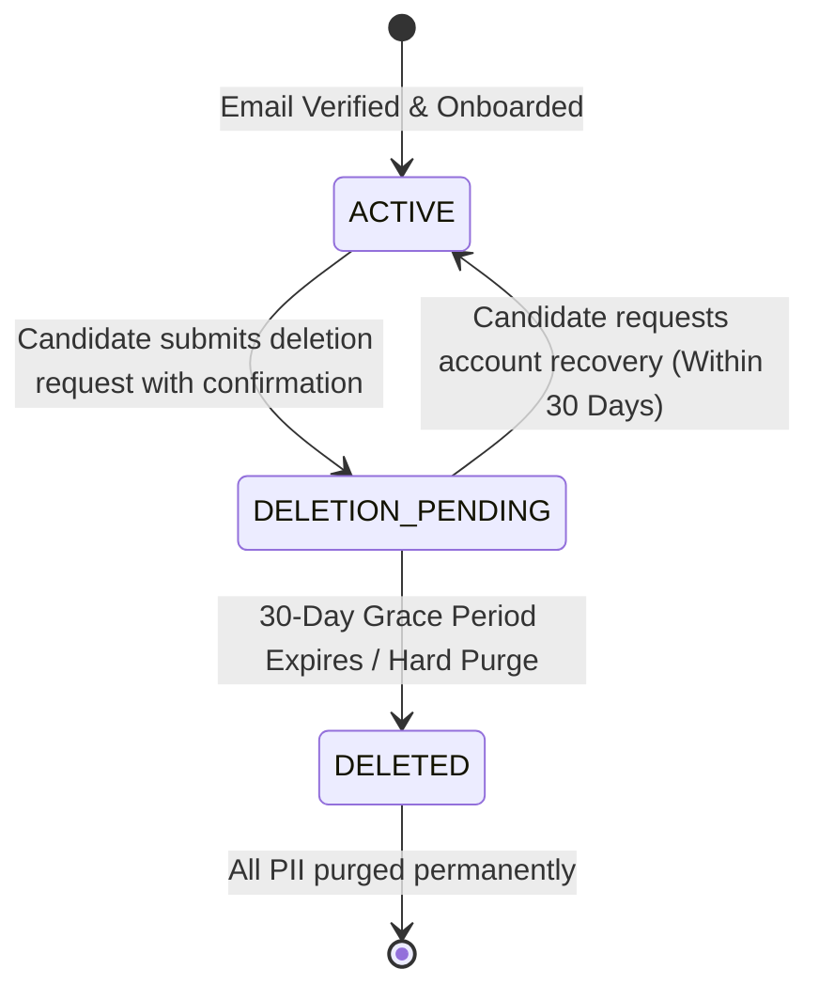

# Account Deletion & Right to Be Forgotten (GDPR / CCPA)

## 1. Regulatory Context

Under Article 17 of the GDPR (Right to Erasure / "Right to Be Forgotten") and Section 1798.105 of the CCPA, candidates possess the unconditional right to request the permanent deletion of their personal data.

**RIGHT FIT** implements a multi-step, auditable account deletion workflow designed to prevent accidental deletions while guaranteeing strict legal compliance and inter-service coordination.

---

## 2. Deletion Lifecycle Architecture



---

## 3. Step-by-Step Deletion Workflow

### Step 1: Explicit Candidate Confirmation
To protect users against accidental deletion or CSRF exploits, the deletion endpoint requires an explicit confirmation string:
- Endpoint: `POST /api/v1/privacy/account/delete`
- Request Payload:
  ```json
  {
    "confirmation": "DELETE MY ACCOUNT",
    "reason": "Transitioning to another career platform"
  }
  ```
- If the confirmation string does not exactly match `"DELETE MY ACCOUNT"`, the API returns `400 Bad Request`.

### Step 2: Immediate Account Transition to `DELETION_PENDING`
- The user's status is changed from `ACTIVE` to `DELETION_PENDING`.
- `scheduled_hard_delete_at` is stamped to `utc_now() + timedelta(days=30)`.
- An `AccountDeletionRequestRecord` is created tracking deletion initiation, grace period expiry, and status.

### Step 3: Immediate Session & Token Revocation
- All active refresh tokens across all candidate devices are immediately revoked (`is_revoked = True`).
- Authentication cookies and tokens can no longer refresh or authenticate API calls.
- The `get_current_active_user` FastAPI dependency rejects further requests from `DELETION_PENDING` accounts with `403 Forbidden`.

### Step 4: Satellite Coordination
- RIGHT FIT's Hybrid Architecture isolates satellite services (`LeadHunter AI`, `Startup Problems Hunter`).
- During account deletion, the Core deletion service coordinates with satellite services to ensure satellite-held candidate records, outreach leads, and cached queries are scheduled for purge.
- Core records the status in `AccountDeletionRequestRecord.satellite_acknowledgments`:
  ```json
  {
    "leadhunter": "PENDING_PURGE",
    "startup_intelligence": "PENDING_PURGE"
  }
  ```

### Step 5: Audit Event Logging
- An immutable security event `ACCOUNT_DELETION_REQUESTED` is created.
- The event records the account ID, client IP, user agent, and timestamp. PII fields (name, passwords, resumes) are omitted.

### Step 6: Hard Delete Execution (Post Grace Period)
- After the 30-day grace period, the scheduled purge worker executes database cascade deletion:
  - Deletes candidate profile, education, experience, and skills records.
  - Purges resumes from object storage (S3/local).
  - Anonymizes transaction history, leaving non-PII financial and aggregate metrics if required by financial auditing regulations.

---

## 4. API Endpoints

| Method | Endpoint | Description |
|---|---|---|
| `POST` | `/api/v1/privacy/account/delete` | Requests account deletion with `"DELETE MY ACCOUNT"` confirmation. |
| `GET` | `/api/v1/privacy/account/deletion-status` | Inspects current deletion status, grace period timeline, and satellite acknowledgments. |

