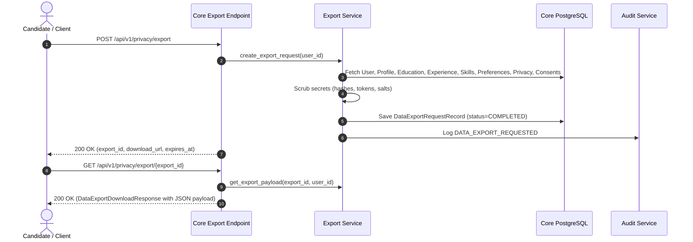

# Candidate Data Export Architecture (GDPR / CCPA)

## 1. Regulatory Context

Under Article 20 of the General Data Protection Regulation (GDPR - Right to Data Portability) and the California Consumer Privacy Act (CCPA/CPRA), candidates have the right to receive all personal data concerning them in a structured, commonly used, and machine-readable format (JSON).

**RIGHT FIT** implements an end-to-end self-service data export capability in the Core Career Engine (`app/services/export_service.py`).

---

## 2. Export Generation Lifecycle

---

## 3. Data Bundle Structure

The exported JSON document contains comprehensive user state organized into domain sections:

1. **`account`**:
   - `id`, `email`, `role`, `status`, `email_verified`, `created_at`, `verified_at`.
2. **`profile`**:
   - `headline`, `summary`, `years_of_experience`, `current_title`, `phone`, `city`, `state`, `country`, `linkedin_url`, `github_url`, `portfolio_url`, `provenance`, `confidence_score`.
3. **`education`**:
   - Complete array of degrees, institutions, fields of study, start/end dates, grades, and provenance.
4. **`experience`**:
   - Complete array of work positions, companies, locations, dates, descriptions, and achievements.
5. **`skills`**:
   - Complete list of skills, proficiencies, years experience, and origin.
6. **`preferences`**:
   - Desired job titles, industries, locations, remote preference, minimum compensation, and alert frequency.
7. **`privacy_settings`**:
   - Visibility settings, AI analysis permissions, opportunity matching permissions, and third-party sharing status.
8. **`consent_history`**:
   - Immutable log of all consent grants, versions, timestamps, and revocations.

---

## 4. Strict Secret Exclusion Guarantee

To protect platform and candidate security, the export pipeline applies an automated exclusion filter. The following attributes are strictly purged prior to JSON serialization:

- ❌ `password_hash` (Argon2id hashes)
- ❌ `token_hash` / `token` (Refresh tokens, verification tokens, password reset tokens)
- ❌ Cryptographic salts or internal secret keys
- ❌ Internal database primary key relations that carry no portable meaning

---

## 5. Security & Access Control

- **Strict Identity Binding**: Exports are bound to the requesting `user_id`. An authenticated user cannot access or download an export generated for another user (`403 Forbidden` / `404 Not Found`).
- **Audit Logging**: Each export request is recorded as an immutable `DATA_EXPORT_REQUESTED` audit event with the candidate's IP and User Agent.
- **Expiration Policy**: Export payloads expire after 7 days, after which cached export records are purged.

